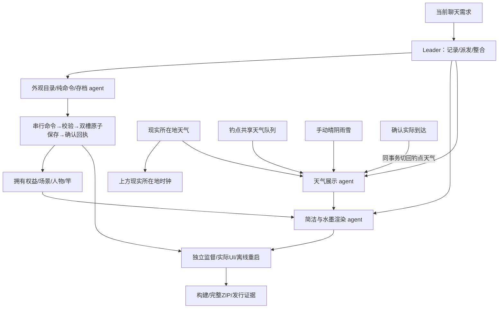

# 水塘时钟

**第一版计划v2补充（2026-10-27）：** 用户已确认五新物各3%、鞋5%、泡水表4%、秘籍2%（鱼74%，不含漂流瓶）；渡口代币改为下一次购买15次主动竿九折，同类不叠加。主动钓鱼／15次特殊竿／四色条均在第一版。[最新主计划](docs/focus-edition-plan/SPEC.md)与[收益对照](docs/focus-edition-plan/roles/economy/README-v2.md)已修订；额外鱼价调整仍待审，没有新功能交付。

**2026-10-27 最新：第一版分流规划。** 本次番茄钟、删除数值鱼竿升级、普通自动钓鱼、15次主动抽鱼与五个新增水域全部属于第一版；第二版尚未定义。本轮先完成[可审批实施计划](docs/focus-edition-plan/SPEC.md)、[分流记录](docs/focus-edition-plan/FORK_RECORD.json)、[区域与矩阵候选](docs/focus-edition-plan/REGIONS.md)及各角色README。15次已确认按进入进度条扣、空挥不扣；25分钟／每日100分钟、自动30%、450金币／15次等仍为建议。本轮没有改变产品、存档或版本号；下方玩法是现有版本说明，后续按批准方案更新。

Windows x64 离线桌面钓鱼挂件。无边框、可拖动、可置顶；金币、鱼获、图鉴、物品、旅途和外观搭配自动保存在本机，无需账号。

**2026-10-26 历史提案：先审批，后微调。** 默认拟恢复真正1.0.x/1.1.x经典剪影，白发移为可选人物包，最初提出六种拾物；后续用户已暂缓漂流瓶、确认其余每种0.2%及平均成功捕获毛收入约50，第一版又因删升级建议暂缓渡口代币。旧提案中的六种／4%不是最新执行表。[历史方案及最新指引](docs/classic-items-proposal/SPEC.md) · [原版与白发候选对照](docs/classic-items-proposal/roles/classic-art/comparison.html)。这些尚未实施。

当前已交付基线是 **1.3.0**。上一轮 **1.3.1白发默认人物**源码/素材/ZIP保留为候选现场，后续按新审批决定转为人物包，不能把候选生成视为本次调整已经发布。[候选素材记录](docs/default-character/README.md)、[候选UI证据](docs/default-character/ACCEPTANCE.md)、[1.3.0历史说明](docs/HISTORY_1.3.0.md)。版本和未测边界见[发行记录](docs/RELEASE.md)。

## 使用与升级

完整免安装 ZIP 必须全部解压，再运行 **PondClock.exe**；保留 resources、locales 和 DLL。使用者不需要 Node、pnpm、WebView2 或开发服务器。先退出旧版，再运行新版。旧版本文件与发行包保留。

进度仍在 `%APPDATA%/PondClock/saves`，与软件目录分开。schema1、schema2 原件先备份，再迁移为 schema3；鱼获、金币、图鉴、物品、修表结果、秘籍与已付航程保持。schema1/2迁移默认简洁；已有schema3的购买权益和搭配原样保留，本次只替换免费`minimal`立绘，不会扣款或重置装备。未来版本和不可写存档会报告错误，不静默清空。设置可导出、导入备份。

拖顶部时钟条移动；展开按钮切换 **420×350 / 640×490**，图钉置顶，“—”最小化，“×”等待已接受的保存完成后退出。设置“移回屏幕”可找回窗口。底部鱼篓、图鉴、渔具店、漫游、设置；面板内滚动，Esc 收起。

## 自选画风与商城

打开 **渔具店 → 美术与外观**。用卖鱼所得的游戏金币收藏，购买后在“我的搭配”分别装备；购买不会直接改变当前画面。

| 商品 | 金币 | 内容 |
| --- | ---: | --- |
| 静水 · 简洁 | 免费 | 原初场景、小小钓客、朴素鱼竿，随时恢复 |
| 山水入墨 · 美术拓展包 | 1800 | 十二地水墨插画、水墨渔翁、墨竹鱼竿 |
| 云游旅人 / 暮色旅人 | 各650 | 原创人物皮肤 |
| 青玉鱼竿 / 晨光鱼竿 | 350 / 500 | 鱼竿外观 |

插画、人物、鱼竿三个槽位可混搭，权益和装备经本地保存确认后生效，重复购买不会再扣款。全部资源内置，断网也能购买和使用。外观不改变鱼竿等级、鱼价、掉落、速度或品质；渔具数值升级仍在“渔具与鱼饵”分区。价格是本版集中配置的游戏数值，没有人民币收费。

简洁背景复用上一版项目自有SVG；1.3.1免费人物采用内置imagegen制作的白发披风透明立绘，晴/雨同身份，保留原比例并独立绘竿，见[素材与提示词记录](docs/default-character/README.md)。其余人物皮肤和水墨美术继续保留。水墨十二景包含秦淮文德桥、淮河涂山、黄河花园口、武汉晴川、福州金山寺、广州沙面、夔门、洱海、万泉河口、北极村黑龙江、塔里木河与纳木错。插画和鱼池分别表示景观与区域水系，不表示某机位的精确生态或垂钓许可。

## 同一风景，不同晴雨

**设置 → 风景不动，晴雨由你**：

- **钓鱼点天气**：背景水域代表景点的天气。
- **现实所在地天气**：背景不变，使用当前 IP 所在城市天气。例如广州沙面背景可以覆盖东莞的雨。
- **手动天气**：选择晴、阴、小雨或小雪，仅改变画面，明确标为手动，不伪造温度或观测时间；夜晚晴天显示月光。

画面同时标明背景地点与天气来源。漫游**实际抵达**后，同笔保存自动切回新钓点天气；飞行途中保留出发地。现实 IP 更新只累计解锁，不自动瞬移。上方时钟始终显示电脑现实时间和现实所在地天气，不受外观、手动晴雨或旅行影响。

“看看远方的天”仍是只读的十二水域天气查看，不买票、不换背景、不改变天气展示选择。天空、云、日月、水面、雨雪和人物雨具/积雪共用一份视觉状态；雨滴触水扩散、雪花轻落消融。

## 单机玩法与记忆

浮漂下沉后点击水塘收竿；50种鱼按十二地区鱼池出现。当地丰富鱼较便宜，稀少或不产地区报价更高；捕获满 **168 个真实小时**的任何鱼固定卖1金币。

成功收竿：鱼98.2%、破鞋1.5%、泡水手表0.2%、网红秘籍0.1%。破鞋卖1；泡水表卖50，或付500试修一次：40%失败、55%普通表10–200、4.9%名贵表1000–9999、0.1%恰好10000。结果原子保存，重开不重抽。

秘籍使用后，之后新钓获且出售时仍新鲜的前3条鱼，按当地原整数市场报价逐条+50%舍入。旧鱼、过期鱼、物品不耗次数，未用完不可叠加。对白、十秒五次点漂的轻微毒舌与离线咕咚鱼讯声保留；设置可静音或关闭后台声音。详见[玩法与存档文档](docs/next-iteration/roles/transactions/README.md)。

现实省区按 IP 免费累计解锁，可在漫游面板免费进入现实区域。游戏机票仍有132条有向航段，依地理距离票价200–6000、飞行60–180秒；退出后航程继续，途中暂停交易和垂钓。

## 联网与离线

定位：[ipapi](https://ipapi.co/api/) / [IPWhois](https://ipwhois.io/documentation)；天气：[Open-Meteo](https://open-meteo.com/en/docs)。服务会看到公网 IP，天气服务收到大致坐标；本机不保存完整 IP。切回窗口、恢复联网与可见窗口每2分钟复查定位，手动入口可刷新。没有读取 Windows 任务栏天气私有缓存。

现实与十二钓点共用有界队列，最多2路运输、至少1秒启动间隔、15分钟新鲜度、最长6小时缓存；429冷却不被手动切换绕过。天气展示选择复用现有快照，不新增请求。设置可关闭联网；断网照常游戏并明确显示缓存或待获取。诊断文字不含完整 IP、位置、路径或存档。

## 开发与监督

当前聊天可实时改需求，由 Leader 记录到[团队收件台](docs/team/REQUESTS.md)，只通知受影响角色。遵守[批准基线](docs/team/BASELINE.md)与[开发规范](docs/style-packs/DEVELOPMENT_STANDARD.md)。角色拥有独占文件并写 README，独立监督先报告问题，再由实现者修复，保存失败和真实未测项留痕。

Node24、pnpm11，现有锁定依赖。常用命令：`pnpm test`、`pnpm run lint`、`pnpm run build`、`pnpm run build:desktop`、`pnpm run package:win`、`pnpm run verify:release`。单测、生产 UI 诊断、普通 EXE 与安装器验收分别记录；生成安装器不等于升级/卸载已通过。

数值与稳定目录在 `src/config/`、`src/data/`；规则在 `src/domain/`；保存会话在 `src/application/`、`src/storage/` 与 `desktop/saveRepository.cjs`；渲染在 `src/components/pond/`，主题在 `src/styles/`。UI 不在渲染时扣款、发放权益或覆盖真实天气缓存。
