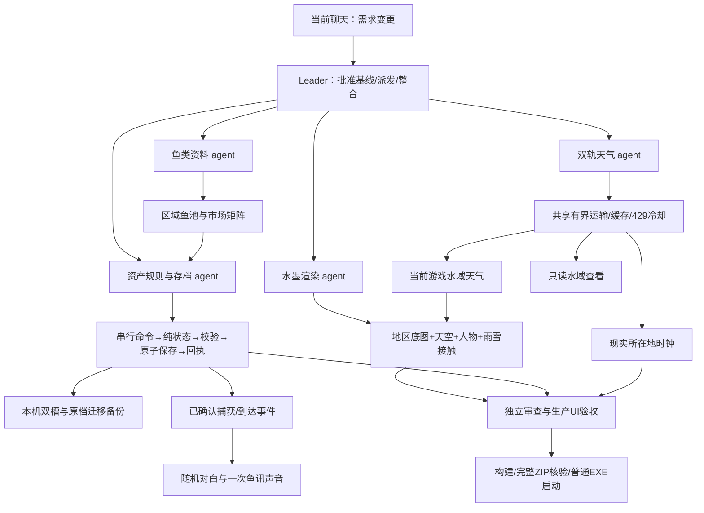

# 水塘时钟 · 水墨垂钓

Windows x64 单机桌面钓鱼应用。无边框悬浮在桌面上，等浮漂下沉后收竿，游历中国 12 个水域。金币、鱼获、拾物、图鉴、设置与航程自动保存在本机，无需账号或线上交易。

当前版本 **1.2.0**，由用户于 2026-10-25 批准 a270e84 推荐方案后实施。完整ZIP和普通EXE已核验，见 [发行说明](RELEASE.md)及[实施与证据](next-iteration/IMPLEMENTATION.md)；历史 1.1.1 说明保留于 [历史文档](HISTORY_1.1.1.md)。

## 使用与升级

推荐完整免安装版 `release/PondClock-1.2.0-x64.zip`。全部解压到一个独立文件夹，打开 **PondClock.exe**，保留 resources、locales 和 DLL。使用者不需要安装 Node、pnpm、开发服务器或 WebView2。

先退出正在运行的旧版，再打开新版。新旧 ZIP 和安装版共用 `%APPDATA%/PondClock/saves`，升级不会另开一个空档。schema1 旧档先保留原始备份，再迁移为 schema2；遇到未来版本、双槽损坏或不可写会报告问题，不静默清空进度。升级前也可以在设置导出备份。

按住顶部“水塘时钟”拖动。展开按钮切换 **420×350 / 640×490**；图钉控制置顶，“—”缩到任务栏，“×”等待已接受的保存完成后退出。窗口位置会记住；设置中“移回屏幕”可找回移出屏幕的挂件。

底部依次是鱼篓、图鉴、渔具店、漫游、设置。面板在挂件内滚动，右上角关闭或 Esc 收起。浮漂下沉时点击水塘收竿；正常鱼讯间隔约 55–125 秒，装备可加速。

安装器历史上仍有旧进程关闭、重装与卸载未完成的验收，不能以生成 EXE 视为已修好。本版主交付为完整 ZIP，安装器状态见 [发行记录](RELEASE.md)。

## 水墨场景与两地天气

12 区分别描绘秦淮文德桥、淮河涂山、黄河花园口、武汉晴川江岸、福州金山寺、广州沙面、瞿塘峡夔门、洱海东岸、博鳌万泉河口、北极村黑龙江、轮南塔里木河、纳木错扎西半岛。景观是水墨艺术表现，水域鱼池覆盖区域水系，不等于某一画面机位的实地鱼类清单。

- **顶部时钟**保留电脑的现实时间，天气按 IP 大致所在地；缺少 IP 坐标时明确使用参考城市。
- **水墨场景**跟随当前游戏垂钓水域的代表地点天气。飞行途中保留出发地，实际到达后切景并显示地点与地址。
- **设置 → 看看远方的天**可以查看全部水域天气，包括未解锁地区；只查看，不买票、不瞬移、不改变顶部所在地。

天空、日月、倒影、云雾、雨雪、水面和渔翁共同使用一份天气视觉状态。阴雪天不出现太阳或金色直射光；雨滴触水扩散，雪花缓落消融；雨天斗笠蓑衣，雪天帽肩积雪。地区不会被永久固定为雨或雪。系统“减少动态”设置会减少动画。

定位流程同时启动 12 水域后台预取，顶部和当前水域优先，联网不阻塞游戏。天气每 15 分钟检查新鲜度，最多保留 6 小时缓存；未知值显示待获取/天气未知，不编造温度。界面明确区分联网、缓存与离线模拟。

没有读取 Windows 任务栏天气的私有缓存；采用 Open-Meteo 模型天气。12 个采样点独立于机票的代表城市坐标；三个官方范围参考点只表示范围核实，不声称精确现场机位或气象站观测，见 [地点与天气开发记录](inkwash/roles/weather/README.md)。

## 现实所在地与游戏漫游

公网 IP 识别到的省区会免费、永久累计解锁对应鱼群水系，接受 VPN/代理结果。已有家乡与钓点不会自动改变；漫游面板的“在当地垂钓 · 免费”可进入当前现实地区。飞行途中先等到达。

切回挂件、恢复联网，以及可见窗口每 2 分钟会复查 IP；左下角地区按钮或设置“立即识别所在地”可手动刷新。自动最短 30 秒、手动最短 2 秒。ipapi 失败自动尝试 IPWhois；限流遵守冷却及 Retry-After，旧响应不覆盖新结果。境外或未匹配结果明确提示，不假装成功。

12 区有 **132 条有向航段**。票价和飞行时间依起点/终点距离计算，票价 200–6000，飞行 **60–180 秒**。已解锁不代表游戏航班免费。付款、起飞与绝对到达时间同笔保存；关窗口后旅途仍继续。途中暂停收竿、买卖和改飞目的地。

## 市场、拾物与小网红

鱼价由品种、品质、重量和当前出售水域供给决定：原产丰富处较便宜，稀少或不产地区较贵。**捕获后满 168 个真实小时，任何鱼固定卖 1 金币**；旅行、断网、重启或秘籍都不会延长保鲜。

每次成功收竿只出一种结果：鱼 98.2%、破鞋 1.5%、泡水手表 0.2%、网红修炼秘籍 0.1%。拾物进入独立物品栏，不混入鱼图鉴；非鱼不耗高级饵，也不推进或清空鱼类保底。

| 物品 | 用法 |
| --- | --- |
| 破鞋 | 卖 1 金币 |
| 泡水表 | 直接卖 50，或付 500 试修一次 |
| 网红秘籍 | 消耗后，之后新钓获且出售时仍新鲜的前 3 条鱼，按当地原市场价 +50% |

修表结果：40% 失败（残值 0）、55% 普通机械表（10–200）、4.9% 名贵机械表（1000–9999）、0.1% 顶级机械表（恰好 10000）。所有区间含端点。顶奖是每次付费修理的千分之一，不是每千次保底。每表只能修一次，结果和固定售价保存，不能重开重抽。修理可能亏损，数值细节见 [事务 README](next-iteration/roles/transactions/README.md)。

秘籍按已提交捕获序号划分新旧，旧鱼、过期鱼和物品不加价也不耗次数。逐条在原整数报价上四舍五入，批卖按捕获先后结算；剩余次数未用完时保留第二本，不叠加。旅行、重启后资格和剩余次数仍在。

## 渔翁对白与鱼讯

对白按事件、地区和当前实际鱼池随机，使用带历史的加权随机袋。十秒内五次点漂会触发轻微毒舌，再点会递进反应，安静 45 秒复位；不会固定几句按索引轮播。到达后随机聊风景、印象或本区域可产鱼；刷新、读档、导入不补播旧到达。

鱼咬钩时短咕咚声随包提供。默认 35% 音量、允许后台提醒，设置可静音、调音量、关闭后台提醒。同一新鲜鱼讯只响一次，恢复窗口不补旧音。若系统拒绝自动播放，可在设置点击“开启声音”；没有声音仍可看漂收竿。

## 联网、隐私与离线

定位：[ipapi](https://ipapi.co/api/) / [IPWhois](https://ipwhois.io/documentation)；天气：[Open-Meteo](https://open-meteo.com/en/docs)。联网服务会看到公网 IP，天气服务还会收到大致坐标；本机不保存完整 IP。设置可关闭联网，离线仍可收竿、交易、旅行、保存和备份。

顶部和 12 水域共用天气队列：实际运输最多 2 路、启动间隔至少 1 秒，每点每 15 分钟最多 3 次、总计最多 26 次。HTTP429 源级至少冷却 15 分钟并尊重更长 Retry-After，手动刷新和重新联网不绕过。设置的“查看联网诊断”只含版本、服务状态和时间，不含 IP、位置、路径或存档。

## 团队对接与开发

当前聊天可随时改需求。Leader 在 [团队对接台](team/README.md)登记变更，只通知受影响 agent，无关工作继续。文件对接台不冒称常驻机器人或外部团队已收到消息。

- [批准基线](team/BASELINE.md) / [收件派发](team/REQUESTS.md) / [开发规范](next-iteration/DEVELOPMENT_STANDARD.md)
- [本版实施与验证](next-iteration/IMPLEMENTATION.md) / [角色文档](inkwash/README.md)
- [鱼类来源与筛选](next-iteration/roles/fish-catalogue/README.md) / [对白与音频](next-iteration/roles/dialogue-audio/README.md)

开发环境：Node 24、pnpm 11；现有依赖已锁定，无需游戏使用者安装。常用命令：

```powershell
pnpm install --frozen-lockfile
pnpm run dev
pnpm test
pnpm run lint
pnpm run build
pnpm run build:desktop
pnpm run package:win
pnpm run verify:release
```



游戏规则与数值集中在 `src/config/`、`src/data/`、`gameConfig.js`；纯规则位于 `src/domain/`；保存会话位于 `src/application/`、`src/storage/`、`desktop/saveRepository.cjs`。UI 只消费已保存状态，不在渲染时发奖或扣费。天气快照版本与游戏存档版本分别管理。
