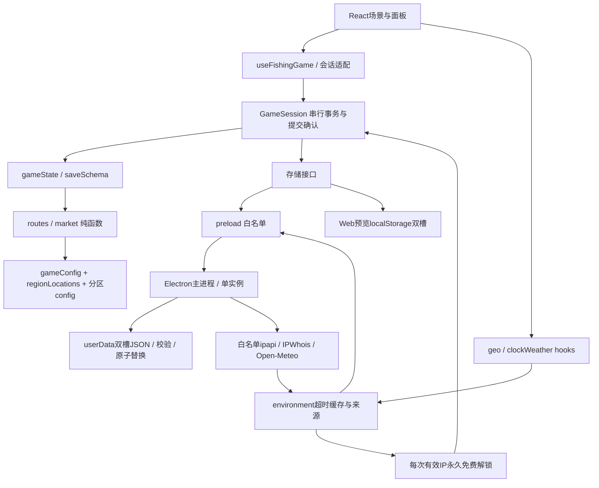
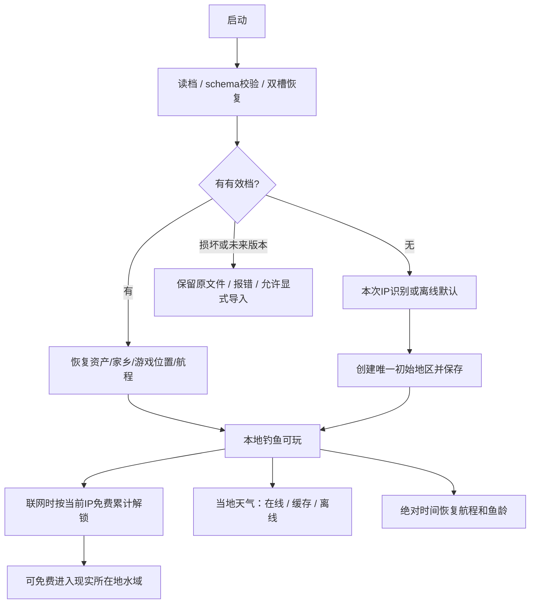
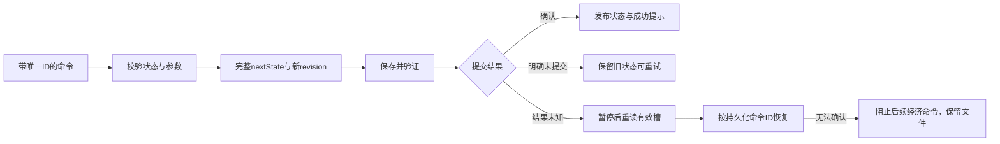
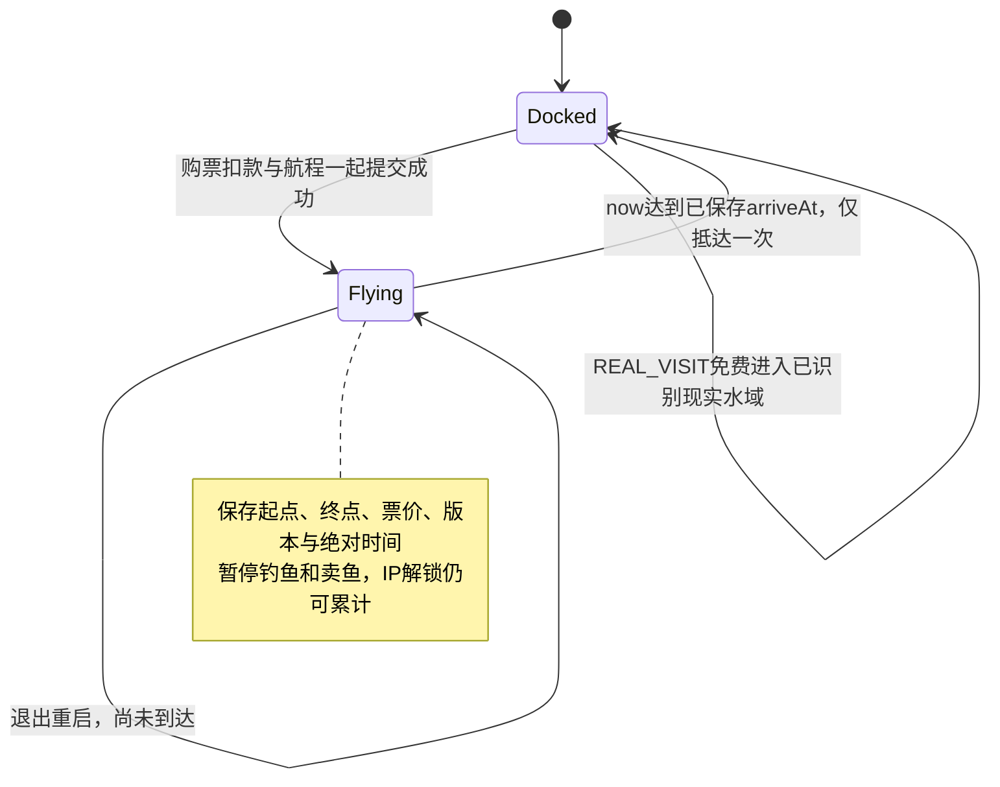
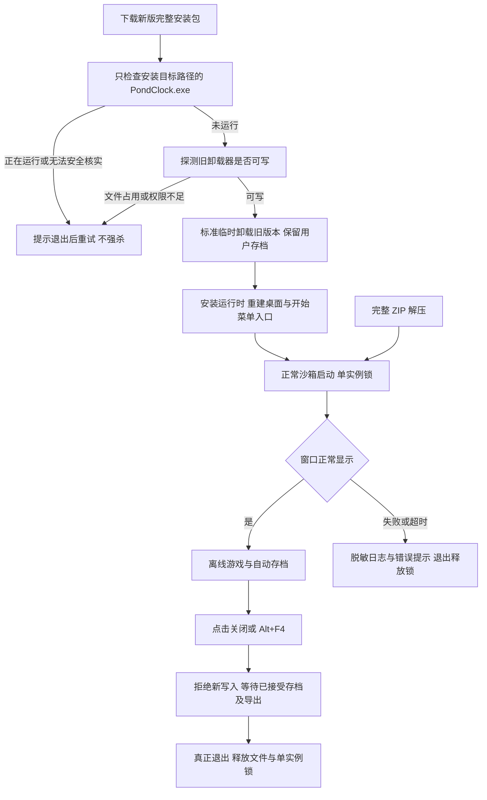
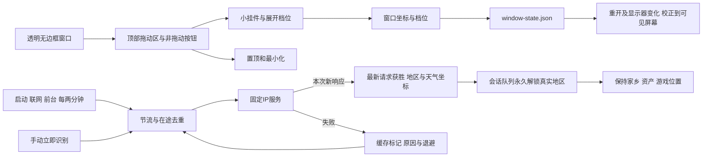
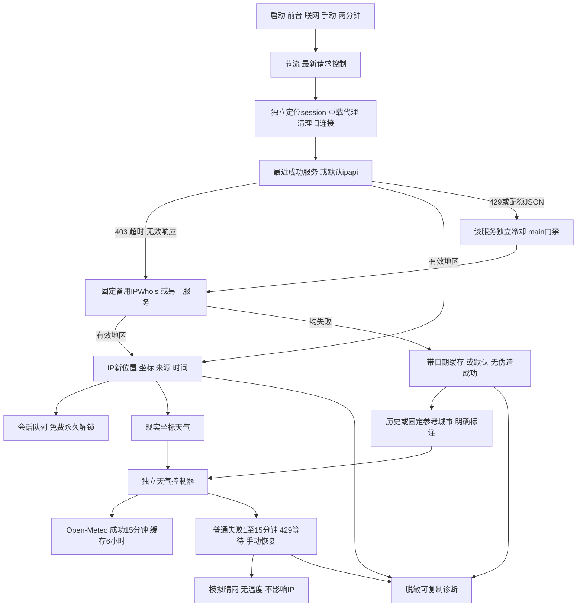

# 实现架构与流程

# 1.0.1 安装、启动与退出补充

此图描述修复后的实现设计。真实安装、升级与正常沙箱运行的通过情况以 [修复验收](REPAIR_ACCEPTANCE.md) 为准，设计图不能代替实测结果。

## 1.1.0 悬浮挂件与网络变化

窗口位置与游戏存档分开；置顶设置仍随完整游戏状态保存。透明区域只负责外观，顶部为明确的拖动区，按钮为非拖动区，不将整个水塘变成拖动区域。实现参考 [Electron 自定义窗口交互](https://www.electronjs.org/docs/latest/tutorial/custom-window-interactions)。没有开启整窗鼠标穿透，收竿与面板仍正常接收点击。

新档定位宽限最多1秒，已有档案立即读取；后台 IP 返回成功后才新增现实到访记录。窗口前台与网络恢复事件只触发服务，不直接结算资产。429冷却保留在主进程与前端，VPN切换不绕过供应商限制。

## 1.1.1 双定位服务与独立天气

端点唯一表`src/config/environmentEndpoints.cjs`由main与renderer共同引用；`services.js`集中时限；IP故障切换和资产解锁分开；`weatherRefresh.js`只拥有天气网络状态。依据：[Electron session](https://www.electronjs.org/docs/latest/api/session)、[IPWhois官方端点与配额](https://ipwhois.io/documentation)。真实与模拟证据分别见[网络修复验收](NETWORK_FIX.md)。
