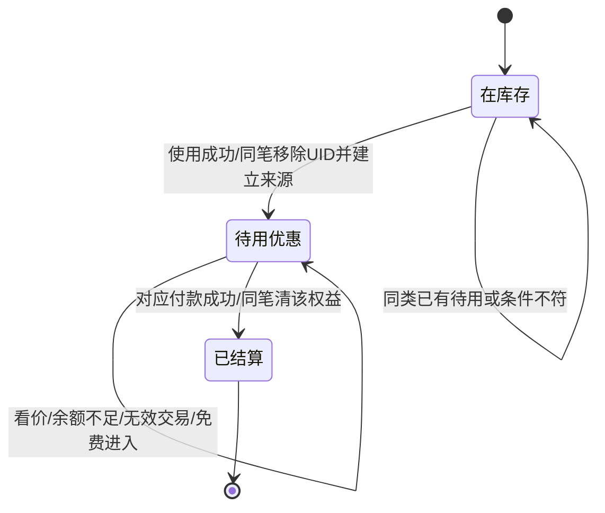

# 独立监督 v2：五种拾物与两类优惠

日期：2026-10-26（Asia/Shanghai）。角色：`proposal_supervisor`。状态：**增量提案复核，待批准实施；未修改产品。** 旧六物记录见[归档v1](README.v1.md)，不继续当作当前提案。[当前复核JSON](REVIEW_CHECK.json)。

本角色只读取源码、角色文档并写本目录。没有改产品、版本、测试、产品脚本、存档或发行包，没有运行EXE或真实网络。既有1.3.1是上一轮候选；本次需求调整不是功能实施批准。

## 当前需求与算术口径

- 漂流瓶暂缓，本轮不开发信笺池、noteId或阅读功能。
- 五种新拾物每种20/10000，即各0.2%；旧鞋150、表20、秘籍10保持，鱼9720，总物品280/10000=2.8%。
- 指南针消耗激活下一次任意有效付费机票九折；渡口代币消耗激活下一次数值鱼竿升级九折。二者不再只读/只收藏。
- 两类各最多一份待用优惠，同类未用时第二件保留，不覆盖、不叠加、不吞物品。
- 用户已确认**成功收竿毛期望平均约50金币**：本地鲜鱼立即出售＋可直接卖的物品，不是单竿固定50或上限50。旧16–40不作为当前目标。

| 新物 | 权重 | 直接卖价 | 另一用途 |
| --- | ---: | ---: | --- |
| `rusty_tin_can` 锈铁罐 | 20 | 3 | 留在库存 |
| `river_shell` 河蚌壳 | 20 | 8 | 留在库存 |
| `ferry_token` 渡口代币 | 20 | 25 | 下一次数值竿升级九折 |
| `sealed_bait_box` 密封饵盒 | 20 | 30 | 高级饵库存+1份，不刷新baitLeft |
| `scratched_compass` 磨花指南针 | 20 | 18 | 下一次付费机票九折 |

卖价沿用提案时，新物直接全卖贡献`20×(3+8+25+30+18)/10000=0.168`金币/成功收竿。旧鞋卖1和旧表不修卖50共0.115，秘籍不可直接卖按0计；因此全成功收竿毛收益为`0.972×条件鱼价均值+0.283`。

这一毛口径不含成本、修表、秘籍未来增值、跨区套利、饵库存替代价值或券省下的钱。新旧掉率直接现金差仅为`0.168−0.01F`，F=16.8打平，不是全程长期收益模拟。达到平均约50的品质/价格方案须另看经济角色的全情境核算；若改品质分布或价格，需显式待审与前后报价表，不能声称原品质收益完全不变。

任一新物概率1%，平均100次成功收竿；单件0.2%，平均500次。仅按基础竿每次90秒且全部及时成功示例，分别约2.5小时/12.5小时，不是保底或实测，不能沿用v1的37.5分钟。

## 激活、待用与付款是两个事务

拟用`ticket10`、`rodUpgrade10`两个独立权益槽，名称由Leader冻结，必须遵守：

激活检查真实uid、类型、落地和该类槽为空。数值竿满级时不激活竿券，保留代币；激活不要求现在已攒够购买金币。移除物品与建立权益同笔保存，确认前不报成功。每份权益至少识别用途、`sourceItemUid`、固定九折规则版本、激活命令；来源不能同时留在items，两槽不能复用同一uid。用途和倍率由纯规则决定，不能信任renderer提供的折扣或应付价。

无新增到期时间，断网、换区、重启保留待用权益。两类可同时存在，但一张机票只用机票权益，一次升级只用竿权益；不能叠成八一折、不能清另一类。同类第二件尝试使用时，原物品和原权益都保留。

### 真正付款

预览与提交必须共用纯报价：机票读取现有路网基价，数值升级读取`RODS[nextLevel].cost`，匹配权益存在时算`Math.round(basePrice×9/10)`；检查优惠后实付余额，再一次提交扣钱、购买结果和清匹配权益。

- 余额540可用竿券买基价600的下一等级，不能先要求原价600。
- 机票基价200–6000对应180–5400；数值竿升级600/2600/9000对应540/2340/8100。这是目录算术，非已执行付款测试。
- 预览、切面板、余额不足、同地/未知航段、满级、飞行中操作不消耗券、不改金币。免费`REAL_VISIT`不是买票，不消耗机票券。
- 外观竿皮肤、鱼饵、修表均不匹配两券。数值鱼竿优惠不能与商城外观商品混淆。
- 写成功而回执丢失时按原命令重读，不盲补券、退款或换ID再付款；无法确认先阻塞恢复。
- 建议报价绑定当前起点/下一等级及权益来源，防止旧面板在状态改变后购买另一项；金额仍由纯规则重算。

## schema4与旧档

schema4一次承接白发新ID、新物品type、待用权益与最小付款凭据，不临时再加第五个schema。schema1/2/3原件先备份，迁移两券初始化为空；不伪造来源、不补发金币。

`ROUTES`基价、132段距离和时长不改。新航程保存基础价、实际`farePaid`、折扣来源与规则版本，抵达/离线续航不再用券。旧航程以原`farePaid`保存历史基础价、折扣为空，不用新票价重算。载入校验历史公式/版本，不要求旧凭据等于未来路网价。

竿升级保留最小可核对付款结果（基价、实付、来源权益、前后等级/命令），无需在线订单系统或无限日志。来源、待用/已结算关系显式校验，同一uid不能在库存和待用权益两处出现。

新掉落表版本与旧秘籍/修表语义版本仍须拆分。旧buff1、待修种子、已修结果、捕获时间/序号、金币、饵余次、航程和其他外观权益保留。新增类型须显式价格/能力分派，不能默认当手表卖50。饵盒移除UID与加1份库存同笔，不刷新已用余次。

168小时鱼固定1、秘籍不加成物品等护栏不变。两券只改对应购物实付，不改高级竿品质权重、掉率、外观能力、鱼价、鱼龄或天气来源。

经典原件取证、免费`minimal`恢复与白发包A/B待批政策继续保留：[历史取证](../classic-art/README.md)。只恢复旧minimal，不覆盖其他已购装备，不把曾使用免费白发当作付费证据。

## 拟验收与待审

1. 10000槽排他总和，5×20、新物1%/总物2.8%、旧三率；经济毛口径与全情境核算一致。
2. 激活/出售同uid竞争、重复激活、同类第二件保留、两类来源唯一且匹配业务。
3. 540/600、180/200等优惠后可付边界；不足实付不吞券。
4. 余额不足、无效航段、免费现实进入、满级、飞行、外观购买均不误用。
5. 付款失败/未知回执/重启不复用源物品；一单不八一折、不清另一类。
6. schema1/2/3→4备份、旧旅途/修表/秘籍兼容、待用与结算凭据、未来档保护。
7. 同源预览/实付/余额提示与最终ZIP；经典轮廓、两背景12区/竿线/雨雪沿用美术验收。

当前没有新功能、迁移、UI、EXE或发行通过声明。主审批稿v2与经济核算在Leader冻结后终审；旧v1审阅hash不对v2自动生效。
