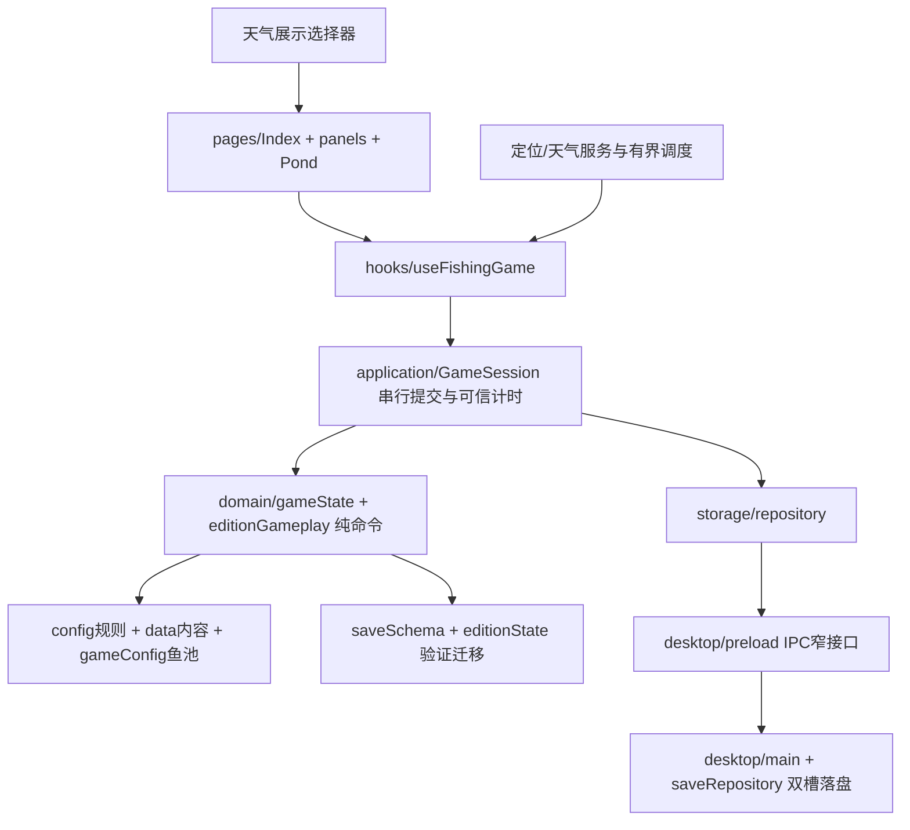

# 开发架构与当前状态

当前：V2.0.1、schema4、editionId first-focus。第一版含全部专注与主动钓鱼玩法；第二版尚未定义。完整文件表见 [FILE_MAP](FILE_MAP.md)，调参见 [CONTENT_AND_BALANCE](CONTENT_AND_BALANCE.md)。

界面发意图，领域生成下一快照，会话校验并保存成功后确认；未知回执按原命令ID重读调和，不换ID再付一次。纯领域不引入React、浏览器alias、平台存储或网络。

## 模块边界

| 层 | 核心文件 | 当前状态与修改原则 |
| --- | --- | --- |
| 页面/面板 | pages/Index.jsx，components/panels/* | 已实现UI；菜单和文本在这里改，不能直接结算资产 |
| 渲染 | components/pond/* | 简洁/水墨、经典/可选人物、天气/水面/浮漂、主动条；仅显示，不决定鱼获 |
| 适配 | sceneViewport.js、useSceneViewport.js | V2.0.1统一cover变换、低岸安全下沿、对白可见范围；同尺寸换水域也重算 |
| 应用会话 | application/gameSession.js | 串行保存、重试、已知命令去重、单调计时信用；避免重放消耗新时间 |
| 普通/主动/专注 | domain/editionGameplay.js、editionState.js | 第一版状态机和奖励账本；开停、进条扣次、重开暂停 |
| 通用资产 | domain/gameState.js | 售卖、修表、物品使用、旅行、购买外观与图鉴记录 |
| 规则与数据 | config/*、data/*、lib/gameConfig.js | 分区管理；gameConfig“全部数值集中”是历史注释，实际V2以config分区为准 |
| 市场/航线 | domain/market.js、routes.js | 从唯一鱼池/坐标推导，避免第二套不一致矩阵 |
| 保存 | domain/saveSchema.js、storage/repository.js、desktop/saveRepository.cjs | 双槽校验和、原子提交、未来版本拒绝覆盖、旧档只读复制备份 |
| 原生宿主 | desktop/main.cjs、preload.cjs、edition.cjs、windowState.cjs、lifecycle.cjs | 无边框/置顶/拖动/生命周期；IPC限制接口，保持sandbox/contextIsolation |
| 环境 | services/environment、weather*、regionWeatherStore，hooks/useGeoRegion等 | IP备用服务、天气队列/缓存/429冷却；不把离线模拟写成实况 |

## 重要不变量

存档`PondClock-Focus/saves`独立于旧PondClock；旧schema1–3先备份原始槽再复制迁移。普通钓鱼关闭不补鱼，专注/主动条恢复暂停，旅途用绝对到达时间继续。关键购买/奖励有持久凭据，不能只靠128条近期命令防重。

顶部显示现实时间/所在地天气，场景可选现实/钓点/手动；背景地点不随天气来源切换。实际抵达后切回钓点天气。粒子与人物雨衣/积雪使用同一个视觉状态。天气观察、游戏时间和可信专注计时不是同一个时钟。

## 已完成与边界

V2.0.0规则回归325通过/1默认安装钩子跳过（另显式验证），真实EXE经过独立样本和加速时钟的界面检查。V2.0.1受影响46项通过、两档×两画风×晴雨雪生产浏览器12组合、点击、同文档切换/旅行通过；65包内文件、76ZIP运行文件匹配。

这些证据分别见docs/v2.0.0和v2.0.1。安装器历史“无法关闭”仍未解决；本版主交付免安装ZIP。2.0.1没有重新声明原生EXE、真实IP/VPN、第二台电脑或长时性能通过。只有单行随机对白被实际触发，多行省略未冒称目视通过。

## 技术债

gameConfig仍保留部分旧装备/演示字段，V2正式玩法不再走数值鱼竿升级。多个历史smoke脚本有旧版本/环境默认值，使用前读脚本注释；新测试应隔离档案，不把历史测试证据覆盖成新版本。生产JS块约555kB有拆包提示；源码目录图像/参考许可和发布镜像策略见publishing。自定义非商业许可不消除模板/第三方权属问题。
