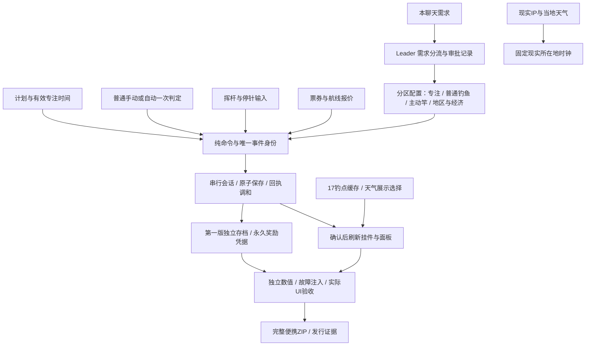

# 第一版：番茄钟与轻量钓鱼实施方案 v1

日期：2026-10-27（Asia/Shanghai）。范围：本次所有新需求只属于**第一版**，第二版尚未定义。状态：**实施前计划，具体推荐参数待审批**；本轮未改产品、未创建第二版、未发布新包。文中“建议”不能当成用户已批准或功能已通过测试。

## 1. 从何时分流

**需求分流点：2026-10-27，本次提出番茄钟／删升级／自动钓鱼的聊天。** 用户随后明确“所有都是第一版，第二版还没给你说”。产品第一、第二版是两个方向，不等于历史1.0.x、1.1.x版本号。

当前最近已交付基线为`96fd232`（1.3.0）；HEAD `1f1a7c7`只是审批文档提交；工作区另有未提交的1.3.1白发候选。已保存[201个产品文件快照](PRODUCT_BEFORE.json)，它是现场记录，不是干净发行基线。

首次功能改动前，Leader先封存准确源码、锁文件、资源和旧包哈希，明确经典默认／白发包候选的取舍，然后建立第一版实施分支，建议名`edition/first-focus`。**目前没有宣称此分支已创建。** 第二版等需求明确后再定分支、功能和版本号；现在不推定它保留哪些玩法。记录见[FORK_RECORD.json](FORK_RECORD.json)。

共享鱼种、天气、外观和保存基础设施的源码；第一版使用独立`editionId`、应用标识和可写存档目录。旧版只读导入，保存副本，不自动双向同步；以后第二版不能覆盖第一版的金币、奖励和次数。

## 2. 已确定的产品要求

| 编号 | 第一版要求 | 可验收解释 |
| --- | --- | --- |
| F1-01 | 删除鱼竿升级功能 | 商店入口与数值升级命令均停用；普通等待、品质不再受旧等级影响。鱼竿皮肤仍为外观 |
| F1-02 | 可制定番茄计划；完成一个番茄钟奖一包高级饵 | 计划、计时、完成记录和发饵持久化；失败保存不得显示领奖成功 |
| F1-03 | 完成一天奖一次免费机票自由行 | 明确当日完成条件；同日只发一次，免费票可选择有效目的地 |
| F1-04 | 普通鱼讯点击必中，不点击也有20–40%成功机会 | 点击成功与自动结算互斥；不点击只判定一次。成功捕获沿用鱼／拾物表，必中不表示必出高品质鱼 |
| F1-05 | 用户可主动停止、开始钓鱼 | 停止后无新鱼讯／收益；再次开始不补停止期间的鱼 |
| F1-06 | 付费特殊竿主动抽鱼，限15次 | **已另行确认：每进入一次收鱼进度条扣1次，空挥不扣**。成功失败均消耗这一次 |
| F1-07 | 平均2–3次挥杆咬钩，小人挥收竿；进度条往返，任意键停针 | 白区0%、红区10%、黄区50%、绿区100%；主动鱼品质权重高于普通 |
| F1-08 | 新增5个中国水域，配套鱼类、市场、机票、图鉴 | 原12区保留，候选扩为17区；全图数据派生，不手填散乱报价 |
| F1-09 | 两个版本从本轮开始区分，第二版之后再说 | 需求／代码基线／存档身份分别留痕；不擅自定义第二版 |

继承：离线可玩与记忆、七天后鱼价1金币、IP累计解锁、现实所在地时钟、场景天气来源可选、旅行到达后切目的地天气、自选画风和人物包。默认经典原剪影及白发独立包方向继续承接；旧案650金币与旧档赠礼仍属待审细节，不能默认为本轮已批准。参考图与鱼类附件仅作资料，文字不自动成为指令。

## 3. 番茄钟首发建议

先做一个紧凑的“今日计划”面板：填写计划名称，固定**25分钟专注＋5分钟休息**；每完成一个完整专注计划奖**1包高级饵，沿用每包5条成功鱼的次数**。暂停可继续，取消不领奖；休息不领奖。**同一档案同时只能运行一个计划**，其余排队，不能并行25分钟领四份或将同一时间计入多个计划。首发不增加自定义时长、项目看板或联网账号。

**一天完成建议定义为：当日完成4个25分钟计划，累计100分钟已确认专注。** 达标奖1张任意目的地的免费单程通票，一天最多一次，不要求开机24小时。票可跨日积攒、不可出售；去程免票，返程另用票或金币。这是对“完成一天／一次机票”的推荐定义，尚待审批。

最小化、失焦时正常计时，让用户能在其他软件工作；暂停、电脑休眠、应用关闭不计，重启恢复暂停进度。采用单调计时及主进程挂起事件，不把系统时钟调快或睡眠当成专注。计时只表示用户运行了计划，不监控其桌面工作内容。

建议以**计划启动时的电脑日历日期／时区**归属整份计划，跨午夜不重复拆给两天；IP与游戏漫游不改归属。每日只统计已完成计划，未完成分钟不提前发票。完成计划、发饵、每日达标发票同笔保存；持久完成记录去重，不能仅依赖最近128条命令历史。细节见[玩法与存档计划](roles/gameplay/README.md)。

免费票起飞同样经历60–180秒正常航程、抵达后解锁，不是瞬移。无效目的地、当前水域、保存失败不扣票；现实所在地免费进入不扣票。与指南针九折并存时明确选择支付方式，免费票不消耗九折机会。

## 4. 普通钓鱼与自动收益

建议采用统一基础竿，等待55–125秒，咬钩窗口20秒；去掉旧等级加速和旧挂机加速，避免额外隐藏变量。用户点击有效鱼讯即100%完成一次捕获；20秒内未点，截止时以**30%**判定一次，参数保持在用户给定20–40%内。自动收获进鱼篓，仍由用户出售；不自动卖鱼、不补关闭软件期间的挂机收益。

开始／停止按钮始终可达。首次打开或重启建议为停止状态，由用户主动开始；停止未结鱼讯不发奖励。普通、主动抽鱼和飞行互斥，番茄钟独立运行；主动交互、飞行或停止时不会暗中再结算普通鱼。自动模式默认不使用高级饵，由用户明确开启；已经生效的剩余次数不能凭模式切换作废。

同一个持久`attemptId`最多结算一次；即使失败也推进尝试序号、随机状态和已结标记。保存失败或回执不明应重读同一结果，不能重新掷。**“每次成功捕获约50金币”与“每小时收益”分开计算**：按毛均50、手动平均2秒响应估算，手动约1957金币可售价值／在线小时；自动等满窗口时，20%／30%／40%分别约327／491／655。若一半鱼讯及时手动、另一半交给30%自动，同口径约1158金币／小时；混合公式为`3600×50×(0.3+0.7q)/(110-18q)`，q为及时手动鱼讯比例。以上不是净利润，也不是实际每小时保底；忽略出售操作、停顿和旅行，自动不会直接增加金币。

当前无升级候选在**旧12区**的成功捕获本地立即出售毛均约47.13–51.91，沿用此前尚未批准的调价／品质方案。该方案涉及47种老鱼基础价上涨，旧鲜鱼也会重报价；不能悄悄作为“只调爆率”落地。新增五区后必须重新校准17区，不能把旧12区结果套过去。完整口径、付费鱼饵成本和计算边界见[经济文档](roles/economy/README.md)。

## 5. 限15次的主动抽鱼

建议商店**450金币购买一支含15次收鱼机会的特殊竿**；旧组用尽后可再次明确购买，不自动续费，不把它做成数值升级等级。挥杆数在2和3之间等概率选择，平均2.5次触发进度条；每次挥杆建议3秒，空挥不扣。这里是固定2／3挥杆抽样，不是每挥杆40%从而可能一直空挥。

进入进度条前，扣次、事件身份、随机种子和未结状态同笔保存，保存成功后才显示可收鱼。建议6秒超时、指针单程1.5秒往返；色带总长度：**白20%、红25%、黄30%、绿25%**。顺序为白10／红12.5／黄15／绿25／黄15／红12.5／白10，使绿色居中、白色在两端。边界使用0–10000整数坐标的半开区间，最后端点归最后白区，UI与域规则共用一表。白0、红10%、黄50%、绿100%的成功率是用户要求；色带宽度、速度、售价是推荐参数。使用颜色以外还要有文字／图形标记。

“任意键”限游戏窗口有焦点、条可见、无编辑框／输入法组合／弹窗输入时；不设全局键盘钩子、不抢其他应用焦点。忽略长按重复与系统组合键；Esc取消按失败处理；另有等效点击收竿按钮。切出窗口暂停条；崩溃后恢复同一个事件，不退次、不重掷。超时、取消、白区或红黄失败都消耗已扣次数。

建议主动成功时**只出鱼**，不混拾物；不耗普通鱼饵，不改变普通保底计数。基于普通无保底品质权重，普通／稀有／史诗／传说分别乘**1／1.25／3.5／5**后归一化。是否真的高于普通长期含保底且有饵，按每区分别计算，不能只看倍率名称。

450／15次候选在旧12区，全绿一组可售毛价值约771–865、扣竿价后约321–415；均匀停针对照成功率42.5%，净值约**亏83–122**。不是稳赚，熟练者的时间收益也可能很高，必须纳入对比。新增五区、市场和价格定稿后重算；首发不额外加入加次数、全绿道具或升级券。

## 6. 道具与删升级的配套

漂流瓶继续暂缓。此前五件新道具尚未实现，**渡口代币原用途是下次升级九折，与本轮删除升级冲突**；建议第一版暂缓它，不能擅自改成主动竿券。其0.2%归回鱼，另外四种新道具仍各0.2%，用途和直售价见[此前道具角色修订](../classic-items-proposal/roles/creative/README.md)。指南针仍是下一次有效付费机票九折，同类未用完时第二件保留，不叠加。

| 成功捕获结果 | 建议权重／10000 | 绝对概率 |
| --- | ---: | ---: |
| 鱼 | 9740 | 97.4% |
| 原破鞋／泡水表／网红秘籍 | 150／20／10 | 1.5%／0.2%／0.1% |
| 锈铁罐／河蚌壳／密封饵盒／磨花指南针 | 各20 | 各0.2% |
| 漂流瓶／渡口代币 | 0 | 暂缓 |

总和10000；物品合计2.6%。本地鲜鱼与道具直售价计毛均，修表中奖、秘籍加价、跨区溢价、票券节省、免费鱼饵和免费机票另列，不虚增“每次捕获约50”的基准。旧鱼七天到期仍1金币。

旧等级导入后归档到legacy字段、停止影响钓鱼。建议按旧等级一次性补偿0／600／3200／12200金币，**这是按等级估算的补偿方案，不声称能证明历史实付金额**；可改为无补偿，由本次审批选择。补偿ID永久去重、仅导入第一版副本，不能覆盖原档；竿皮肤购买不算等级补偿。

## 7. 五水域与图鉴

候选新增太湖、洞庭湖、嘉陵江、白洋淀、胶东威海近海，保留原12个ID，合计17。新增3种名录A类海鱼＋3种区域补充淡水鱼，图鉴50→56；新增鱼不是重命名旧鱼，花䱻与现有唇䱻分开。

配套候选已导出**272条有向航线、952项鱼种×市场供应系数**，新航段140条。当前坐标仅是规划近似点，地理复核后再进入产品；具体鱼池、图鉴资料、美术／天气与报价变化见[区域计划](REGIONS.md)。全图距离仍按60–180秒、200–6000金币归一化。

加入近距离区域会改变全图最短距离，因此本候选会重报价128条旧航段、重算130条旧航段时长；已付款的旧航程保持原票价、出发／抵达时间和规则快照。市场也可能因新供应改变旧报价。必须新规则版本、输出差异，不承诺旧市场／未来新购票价格不变。

新增水域同步有简洁场景、已购水墨包对应插画、天气参考点和鱼图鉴；主时钟始终现实所在地。IP只有可信城市匹配才累计解锁相应细区，省级结果仍落原宽区，不将“河北”直接认作白洋淀、“山东”直接认作威海；已解锁宽区不批量赠新细区。天气队列扩至17个钓点仍沿用2路、启动间隔／缓存／429限制，不突发17并行请求。

## 8. 架构、实施顺序与验收

| 阶段 | 交付 | 完成门槛 |
| --- | --- | --- |
| P0 计划定稿 | 本方案、参数选择、分流记录与候选数据 | 用户明确批准的范围留痕；建议参数不能默默转批准 |
| P1 基线与隔离 | 封存候选，第一版分支／目录；旧档导入与删升级 | 原档不变、未来档不覆盖、补偿与事件身份幂等 |
| P2 番茄钟 | 计划、暂停恢复、发饵、每日票 | 后台／睡眠／重启／跨日／写失败／重复完成均验证 |
| P3 普通钓鱼 | 开停、点击必中、一次自动判定 | 手动与自动同帧只结算一次；停止／离线无补鱼 |
| P4 主动竿 | 15次、挥收竿动画、四色条和键盘 | 空挥不扣；失败不退；重启不重抽；不干扰其他软件 |
| P5 水域图鉴 | 五区、六鱼、场景天气、全图矩阵 | 17区收益重算、272航线、56鱼无孤儿ID、来源核对 |
| P6 独立验收发行 | 小／大窗口、离线存档、普通EXE、完整ZIP | 规则与实际界面分别留证；安装器未验事项继续单列 |

按并发容量分批：Leader独占总文档／接线／发行；事务角色独占schema和会话，专注角色独占专注纯规则，钓鱼角色独占attempt与状态机；区域数值角色独占鱼池／市场／航线，美术角色接场景和动画；监督角色独立复验。共享文件一人写，交接接口后再换负责人，不能为了并行拆出多套扣款／保存逻辑。

沿用现有Node24、pnpm11、Electron／React，不为番茄钟引入新计时框架或在线服务。先模块规则与失败保存测试，再生产UI、普通EXE和发行核对；统计概率同时做边界确定性测试和有固定种子的分布检查。实际实现前确定计时检查点上限、停针输入时钟契约与存档schema版本，不把复杂逻辑继续堆进大hook。

## 9. 此次审批对象

用户已确认的“全部第一版／第二版未定义”“15次按进度条扣”无需重复确认。待审的是这份具体实现计划及以下推荐参数：

- 25分钟计划、5分钟休息、每日4次／100分钟；每计划1包5条高级饵，每达标日1张可积攒单程通票。
- 普通自动30%、统一基础竿节奏、关闭期间无挂机收益；默认由用户主动开始。
- 450金币／15次特殊竿、2或3挥杆、四色20／25／30／25及品质倍率。
- 暂缓渡口代币、四件新物各0.2%候选表；老等级按级补偿或选择不补偿。
- 五区／六鱼候选，以及为毛均约50所需的鱼价和品质调整；17区需实施前重算，旧鲜鱼报价变化明示。

**当前是可审批计划；本轮通过的是文档与计算检查，产品实施、17区完整平衡、实机和安装验收均未完成。**
