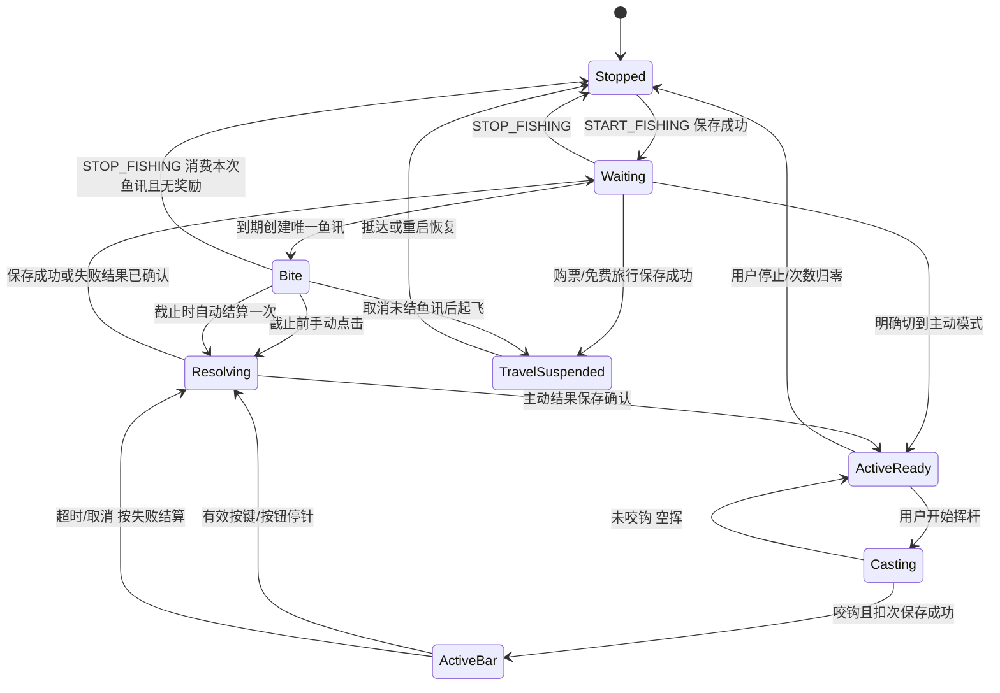

# 第一版：玩法、专注与存档实施计划

负责人：focus_gameplay_plan。日期：2026-10-27（Asia/Shanghai）。状态：计划，不是已实现或通过验收的产品。本角色只维护本目录；Leader 维护总计划、收件台与审批记录。

## 1. 用户要求与待定解释

本次提出的删升级、番茄钟、普通自动钓鱼、主动抽鱼和新增五水域全部属于第一版。第二版尚未描述，不能默认为当前完整版、复制发行或替它确定玩法。需求分流点记录为2026-10-27；首次功能修改前冻结可复现源码/发行基线，第一版使用明确 editionId 与独立存档目录。第二版只有在需求明确后才创建产品配置与分支。

| 用户已明确 | 本角色的待审工程建议 |
| --- | --- |
| 第一版删除鱼竿数值升级 | 删除升级入口与 BUY_ROD 行为；保留竿外观商品。普通钓鱼采用统一基础参数，限次主动竿单列许可证/次数，不伪装成升级等级 |
| 可制订番茄钟计划；完成计划奖励一包高级饵；完成一天奖励一次免费任意机票 | 一项计划先定义为一个25分钟有效专注块；可暂停/继续/取消；休息5分钟不领奖；一天默认目标为完成4个完整25分钟计划、累计100分钟已确认专注，不要求开机满24小时。首发不提供自定义时长，未完成计划的运行分钟不计每日达标 |
| 普通鱼讯点击必中，不点击也有20–40%概率自动中鱼 | 在同一个鱼讯窗口，截止前点击100%成功；无人点击则截止时按配置中的单一概率结算一次，建议30%。20–40%范围不等于每秒反复抽 |
| 可以主动开始、停止钓鱼 | 启动/停止独立于番茄钟；停止后不再计鱼讯、发声音、结算新收益。专注可以独立继续 |
| 付费特殊竿，主动抽鱼限15次；平均2–3次挥杆咬钩；白/红/黄/绿成功率为0/10/50/100%；品质权重更高 | 用户已确认每次触发收鱼进度条扣1次、空挥不扣；购置价、补充次数、色带宽度、指针速度与品质倍率待数值方案 |

“必中”指有效鱼讯点击后100%完成一次捕获；是否仍可能钓到旧道具沿用掉落表需在主计划写明。若用户想手动点击只出鱼而完全不出拾物，要额外改变掉落规则，不能暗中实施。

## 2. 已读取的架构与缺口

- `src/hooks/useFishingGame.js`：当前 idle/bite/saving 和 due 存在 renderer 的 ref；每秒扫描，错过咬钩窗口就丢失；每次启动自动进入下一次等待。尚无停止模式、自动成功/失败记录或主动进度条。
- `src/domain/gameState.js`：CATCH 校验 expectedCatchSequence，按种子形成鱼/物品；鱼获、图鉴、鱼饵、保底同事务；没有持久化 biteId/attemptId，不能以重复定时器派发新 CATCH 来实现自动钓鱼。BUY_ROD 直接扣款、升级，需要同时移除域命令能力与UI入口。
- `src/application/gameSession.js`：串行命令、确认保存后发布、回执丢失重读调和可复用。128条 recentCommittedCommandIds 只能防近期重复，永久奖励不能仅依赖该有界列表。
- `src/domain/saveSchema.js` 与 `src/config/storage.js`：目前 schema3、rodLevel 强制在旧目录范围内；旧字段不能直接删掉而不迁移。未来 schema 拒绝覆盖原则继续遵守。
- `desktop/main.cjs`：默认 `%APPDATA%/PondClock`，Windows APP_ID `cn.pondclock.desktop`；第一版需要独立 profile/APP_ID 决策，不能让两个规则版本轮流覆写同一文件。

## 3. 状态机与事务边界

普通、主动、飞行互斥；番茄钟是独立状态机，可在飞行或停止钓鱼时专注。首次打开与每次重启，钓鱼均恢复为停止状态，需要用户明确开始；不补关闭期间收益。主动未决事件可以保留并等待明确恢复，但不能在重启后自动挥杆、走条或领奖。打开商店、编辑任务或输入文字时不能顺便触发主动停针。普通模式切主动模式必须先关闭/消费当前普通鱼讯，不能同时结算两个来源。

建议命令职责为 START_FISHING、STOP_FISHING、OPEN_BITE、RESOLVE_BITE、BUY_ACTIVE_PASS、CAST_ACTIVE、STOP_ACTIVE_BAR、START_FOCUS、PAUSE_FOCUS、RESUME_FOCUS、CANCEL_FOCUS、COMPLETE_FOCUS、START_TRAVEL。名称待实现统一，不是现有接口。

鱼讯身份至少包含唯一 attemptId、regionId、mode、ruleVersion、biteAt、expiresAt、resolved 标记。自动失败也必须推进尝试序号并持久化消耗本次鱼讯；不会增加成功捕获序号、图鉴、鱼饵消耗或保底计数。随机结果由状态种子及尝试身份生成，不能因保存失败、重启或重新渲染重抽。手动与自动同一队列竞争：手动有效条件为接受输入时间严格早于 expiresAt；等于截止按自动处理。二者最多产生一次结果。

成功捕获仍复用鱼/物品、捕获原地、真实捕获时间、图鉴、鱼饵、保底的纯规则及原子保存。普通手动/自动区别在成功率，不应暗设相反的高品质优势。普通模式建议沿用仅成功钓到鱼才消耗高级饵的规则，失败不扣饵。自动钓鱼默认不使用高级饵，必须由用户主动打开“自动使用高级饵”设置后才消耗；普通手动成功可按已启用的普通鱼饵规则使用。UI须显示两种使用来源，不能让自动收益悄悄消耗番茄钟奖励。主动模式成功只出鱼，不混拾物、不耗普通高级饵、不改变普通保底计数，采用总方案独立品质权重。

主动竿按用户已确认口径每进度条扣一次，进入 ActiveBar 前必须原子保存 passId/attemptId/remainingUses 与未结事件，成功、白条失败、红黄随机失败、超时、主动取消均不退次数；空挥不扣。崩溃恢复同一个未结事件，不返次、不产生额外鱼获、不重抽随机结果。进度条恢复时先暂停，不在后台无人可见时漂移或替玩家按键；明确继续后再运行。未来若改动扣次口径，必须作为新需求重算价格与收益，不能仅改文案。

## 4. 番茄钟有效时间、奖励和每日边界

建议状态为 planned/running/paused/completed/cancelled；同一档案同时最多一个 running 番茄计划，其余计划排队；禁止并行计时，同一有效专注区间不能计入多个计划，不能并行25分钟领取4包鱼饵或直接达成每日奖励。每次完成后的奖励是该计划生命周期的一部分，不能 completed 改回 running 重领奖。计划创建后固定计划ID、目标有效毫秒、所属本地日、时区和当日目标快照。开始后减少目标、改日期、改时区不能把已完成时间再算成新计划。

有效专注时间仅累计应用存活且系统未挂起的 running 区间；最小化、失焦和后台继续，用户可以在其他软件工作。暂停、休息、电脑睡眠和应用关闭均不累计；重启后以 paused 和已确认累计时间恢复，不补离线时长。不能依赖每秒 UI setInterval 次数表示完成分钟；应复用单调时间并在主进程可用的挂起/恢复事件中切断区间，定期保存检查点。断电最多损失一个检查点区间，界面明确已确认进度；该窗口上限在实现时确定。

首次满足计划有效时长时，同一持久化事务将计划标 completed、追加永久完成凭据，并增加 baitCount 一包。若该完成同时达到当日目标，同事务创建唯一 `dailyTravel:<editionId>:<profileId>:<dateKey>` 免费票凭据。奖励成功后再弹提示。重复按钮、重启、导入同一存档、超过128条命令后的重放均不得再领奖。

建议每日完成标准为当天完成4个完整25分钟计划，累计100分钟已确认专注；未完成计划的运行分钟不计每日奖励，日期固定使用计划开始时的系统日历时区，IP变化、游戏旅行不改日期。一份跨午夜计划归开始日；不把同一段时间分给两天。首发固定25分钟专注加5分钟休息，不提供自定义时长或每日目标下调；用户可修改未来计划名称，不能把未完成分钟凑成一个已完成计划。纯离线产品不承诺抵抗系统时钟篡改，只保证自身事务一致；回拨时不生成新的同日奖励，真实时间防倒退护栏继续保留。

免费票建议为不可出售的单程任意有效目的地通票；每完成一日得一张，最多每天一次，可跨日积攒，不设隐形到期或隐藏丢弃；存档容量和安全整数边界只报错，不吞票。使用时清楚显示0金币、原价与目的地；消耗一张票及创建正常航程同事务，仍飞行60–180秒并到达解锁。无效目的地、当前水域、余额/保存错误、已在飞行中均不消耗票。免费真实所在地进入不消费通票。免费票与九折机票同存时先让用户明确选择支付方式；免费旅行不消耗九折优惠，不能偷偷浪费优惠。

## 5. 任意键与桌面宠物交互

“任意键停针”仅在游戏窗口有焦点、主动收鱼条已准备并可见时监听本窗口 keydown；不注册全局键盘钩子，不拦截其他应用输入、不抢焦点。忽略 repeat、输入法 composition、编辑框/任务编辑器/弹窗中的输入，以及系统组合键。Esc 作为取消，不应同时随机停针。可补一个同等时机的点击“收竿”按钮，方便鼠标/触控和无障碍；是否算偏离“任意键”需在UI说明中保持一致。

指针本身是左右往返显示，停针位置来自同一规则时钟和已确定速度/色带，域命令不得直接信任UI传入“绿色成功”。白区直接失败、绿区直接成功，红/黄使用尝试身份固定的一次随机抽样。长按只处理首次按键；切出窗口暂停主动条，不接受桌面打字作为停针。

专注时鱼讯声音可按用户设置静音，自动结果可合并为阶段摘要，避免每次冒泡破坏专注。主动模式不自动开始，也不在番茄钟完成时弹出夺焦。

## 6. 删升级、分流与兼容

实施前冻结源码提交、锁文件、资源和上一版完整包哈希；本轮只定义第一版规则。建议第一版 `editionId: focus-v1`、独立 userData 目录与独立Windows APP_ID，原版目录只读导入，不覆盖；第二版 editionId 和产品目录等需求明确后再定。两版本未来可以共享只读鱼种/美术目录的源代码，不共享可写金币、奖励、次数或命令账本。一次导入后两个进度独立，不自动双向同步。

旧档数值 rodLevel 不能继续生效，建议转成 `legacy.rodLevel` 审计字段；已花金币是否按旧等级累计费用一次退还，必须由用户/Leader批准后才写迁移。退款需固定 migrationId 和永久凭据，旧原件字节先备份，失败不宣称成功。其余金币、鱼获UID/真实鱼龄、图鉴、物品、修表结果、秘籍、外观所有权、已付航程原始价与抵达时间保留。新规则不重算旧已付票、不改旧鱼品质或捕获时间。

上一份尚未实施方案的渡口代币是升级九折券；第一版已无升级对象，不能按旧案直接开发。建议第一版暂不掉该物，已知旧提案不是实际已获资产；若导入某未来含此道具的档，应显示待处理并保留原件，不静默丢弃。替代为主动竿购买优惠或补充次数是额外需求，需另批。指南针机票九折与免费票分别建独立凭据。外观竿继续是纯美术，主动竿通行次数另存，不让皮肤改变数值。

## 7. 建议模块所有权和实施顺序

| 阶段/负责人 | 预期独占模块 | 交付和依赖 |
| --- | --- | --- |
| Leader/基线 | edition配置、总README、需求收件台、发行清单 | 先冻结与分流；仅对第一版实施 |
| 存档与事务 | saveSchema、gameSession、repository、desktop保存 | edition隔离、旧档导入、永久奖励凭据、未决事件恢复；先给玩法纯接口 |
| 专注模块 | focus配置、focus纯规则、计时adapter、任务面板 | 专注计划、有效时间与奖励；不绕过会话直接加饵 |
| 钓鱼模块 | fishing配置、attempt纯规则、useFishingGame协调 | 普通开始停止/自动结算/主动15次；把复杂规则移出现有大hook |
| 交互/美术 | 主动条组件、人物挥收竿动画、专注紧凑面板 | 读状态展示，等待保存确认；不在动画回调直接创造鱼 |
| 区域数值 | fish/regions/routes/market元数据 | 五区独立ID、鱼池/市场矩阵/航线及兼容，不能复用旧ID冒名替换 |
| 独立监督 | 故障注入、持久化与UI证据 | 与作者分离；先报告可复现问题再复验 |

实施顺序建议为：明确数值与计数口径 → 分流/存档隔离 → 删升级兼容 → 番茄钟及奖励 → 普通手动/自动/停止 → 主动条和次数 → 五区与图鉴 → 独立验收/发行。每阶段写自己README、接口/配置决策、已测与未测；共享文件一个写者，跨域改动先交接。

## 8. 可判定验收条件

1. 普通鱼讯在截止前点击一次必成功，同鱼讯点击与自动并发只生成一个结果；自动的20–40%使用受控样本检验，而非几次试玩结论。
2. 自动失败不增加捕获或图鉴，重启不重抽且钓鱼保持停止；停止后过原截止也无新收益，开始时不会补停止期间的鱼。自动默认不消耗高级饵，明确开启后只在成功鱼获时消耗。
3. 25分钟完整有效计划只奖一包；暂停/睡眠/关闭不累积，后台工作正常累积；仅完成4个计划才达每日奖励，未完成分钟不计；跨午夜整份归启动日。同日只发一张免费票，长命令历史后也不重发，跨日持有不丢弃。
4. 存档写失败/回执丢失发生在发饵、发票、扣票/起飞、主动扣次/收鱼的每个边界，余额、次数、凭据和结果保持同事务，确认前不提示成功。
5. 主动白/红/黄/绿对应0/10/50/100%；一次按键停止一次，连按/长按/在编辑框打字不多结算；其他软件打字不被监听或抢焦点。
6. 主动15次耗尽后无法再开始计费尝试；余额不足不扣钱/加次数；崩溃恢复同一未决事件，不重抽、不返次、不多鱼；空挥扣次规则与最终批准一致。
7. 第一版无数值升级按钮和可调用升级命令；旧档竿级不再影响等待或品质，原档及已购美术保留；退款方案未批则不擅自退款。
8. 已付旧航程、现实IP累计解锁、七天鱼价、天气手动/现实/钓点选择和顶部现实时间不回归；未来第二版不覆盖第一版存档。

本轮未跑产品测试、未改版本、未生成安装包。以上是实施与验收计划，不是通过记录。