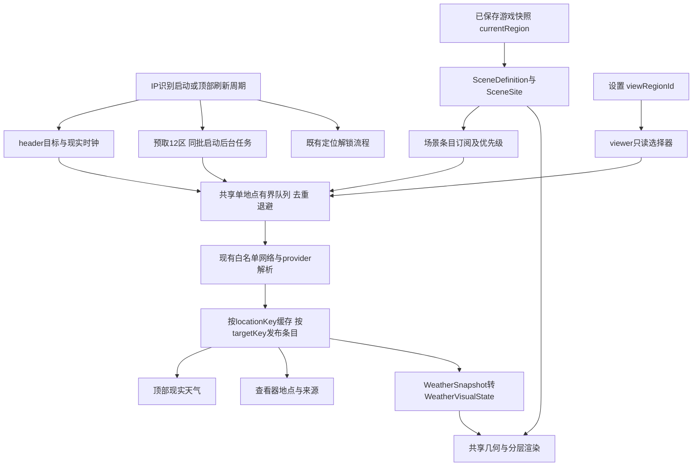

# 水墨改版：架构契约与模块交接

日期：2026-10-23（Asia/Shanghai）。基线：1.1.1／`6685447`。本轮只交付架构设计；未改游戏代码、未请求真实 IP／天气、未执行新功能验收。下文文件、接口和预算均为**待实施、待验证**。

## 1. 意图、输入与权限

输入：[总入口](../../README.md)、[需求 R01–R12／A01–A13](../requirements/README.md)、[美术选题](../art-direction/README.md)、[审查 G01–G13](../review/README.md)，以及现有 Index、Pond、天气服务、游戏模型。适用父目录与项目内未发现 AGENTS.md。本角色只新增本 README；输出是主数据契约、未来文件所有权和集成顺序，不创建实现文件或最终景点坐标。

已核对的基线事实：`Index.jsx` 把同一 `env.weather/hour` 传给时钟与 Pond；Pond 无地区输入；`environment.js` 丢弃原始天气代码，仅留四标签；`weatherRefresh.js` 已有缓存、generation、退避；`gameState.js` 的 ARRIVE 经 GameSession 保存确认后才发布新 currentRegion；`routes.js` 从 REGION_LOCATIONS 生成 12×11＝132 条有向航段。

硬边界：保留 12 个 regionId、航线点、票价／耗时、鱼价／七天保鲜、IP 免费解锁、资产命令、存档 schema 和离线流程。场景地点独立建表，不把哈尔滨航线点改成北极村，不把省会天气标成景点当地天气。不引入新引擎、新游戏时间系统或永久积雪字段。

## 2. 三个上下文与唯一状态来源

| 上下文 | 唯一选点依据 | 允许改变 | 不具备的能力 |
| --- | --- | --- | --- |
| header | 当前有效 IP 坐标；失败沿用已有缓存／参考点并明确标识 | 顶部现实地点、天气及其请求状态 | 不写 currentRegion，不跟机票目的地切换 |
| scene | **已提交**的 `game.currentRegion → SceneDefinition → SceneSite` | 当前景观、场景天气、地点标签 | 不接受 viewer 选择或现实 IP 天气代填 |
| viewer | 设置内存态 `viewRegionId`，初值可为 currentRegion | 查看目标、该条目刷新／排队优先级 | 不调用 travelTo／REAL_VISIT／GEO_VISIT，不写资产或存档 |

scene 与 viewer 订阅同一份 12 区天气仓库，各自选择条目；viewer 不创建第二套天气控制器。header 维护独立目标身份，网络运输与同坐标数据可去重，但显示标签及失败状态按上下文绑定。顶部现有 `regionName` 来自游戏地区，UI 接线时须明确标为游戏水域，不能让它冒充现实天气归属。



图中 G 只沿用原有 Index→游戏命令路径；天气仓库、队列、查看器和绘制层均无指向 G 或资产仓库的反向调用。

## 3. 主数据契约

以下为 JS 项目的文档类型约定，不要求引入 TypeScript。`null` 表示未知，不能自动解释为零、晴天或已观测。对象按不可变快照发布；新字段通过解析、缓存、hook 与消费者整链路交接。

```ts
type SceneDefinition = {
  sceneId: string; regionId: RegionId; siteId: string; revision: number;
  viewBox: { width: 1000; height: 440 };
  geometryId: string; layers: LayerAssetRef[]; // 本地资源，按声明顺序绘制
  // geometryId解析出岸线、水域遮罩、遮挡层、人物/竿线/漂/点击锚点
};
type SceneSite = {
  siteId: string; sceneId: string; regionId: RegionId; siteRevision: number;
  place: string; address: string; timeZone: string | null;
  weatherLocation: { latitude: number; longitude: number } | null;
  coordinateSource: { url: string; checkedOn: string } | null;
  verification: 'pending' | 'verified';
};
type WeatherSnapshot = {
  schemaVersion: 2; provider: string; locationKey: string;
  weatherCode: number | null; temperatureC: number | null;
  isDay: boolean | null; cloudCoverPct: number | null;
  precipitation: { totalMm: number | null; rainMm: number | null;
    showersMm: number | null; snowfallCm: number | null;
    intervalSeconds: number | null };
  observedAtMs: number | null; fetchedAtMs: number | null;
  source: 'online' | 'cached' | 'simulated';
  quality: 'complete' | 'partial' | 'legacy' | 'simulated';
};
type WeatherEntry = {
  targetKey: string; generation: number; snapshot: WeatherSnapshot | null;
  status: 'idle' | 'queued' | 'refreshing' | 'ready' | 'degraded';
  errorCode: string | null; retryAtMs: number; lastAttemptAtMs: number | null;
};
type WeatherVisualState = {
  sky: { coverage: 'clear' | 'partly-cloudy' | 'overcast' | 'unknown'; fog: boolean | null };
  celestial: { sunVisible: boolean; moonVisible: boolean; starsVisible: boolean;
    reflectionVisible: boolean; directLightVisible: boolean };
  precipitation: { kind: 'none' | 'rain' | 'snow' | 'mixed' | 'unknown';
    intensity: 'none' | 'light' | 'moderate' | 'heavy' | 'unknown';
    basis: 'measurement' | 'code' | 'simulated' | 'unknown' };
  waterResponse: 'none' | 'rain-impact' | 'snow-dissolve';
  fisherman: { rainGear: boolean; snowTarget: number };
  daylight: { isDay: boolean | null; basis: 'provider' | 'location-clock' | 'unknown' };
  quality: WeatherSnapshot['quality'];
};
```

- **SceneDefinition 只管画面。** `geometryId` 的解析结果由渲染角色维护，至少提供同坐标水域命中判断与裁切、岸体排除、遮挡、姿态相关竿梢及浮漂端点。坐姿需有新座位／握点定义，不把现有 feetY 偷换为坐骨。SVG defs ID 按实例前缀隔离。
- **SceneSite 只管现实地点。** 一个现有 regionId 对应一个当前代表地点，不增加可切换钓点玩法。地点表须覆盖原 12 ID；三地先用黑龙江／秦淮／珠江样板，名称与候选依据见美术文档。数字坐标未核实前保留 pending，不以城市坐标代填。未验证条目禁止真实天气请求，只显示诚实的未配置／模拟状态；全 12 区正式交付前必须全部 verified。
- **身份分两层。** `locationKey = provider + requestSchema + canonicalCoordinates`，只表示气象查询点；精度规则统一定义，比较与缓存使用同一规则，不能用取整把不同景点混为一处。`targetKey` 属于 WeatherEntry：header 使用 `header:<locationKey>`，scene 使用 `scene:<siteId>@<siteRevision>`；viewer 读取相同 scene 条目。景点坐标／版本改变会得到新条目，标签从当下 SceneSite 绑定，缓存不存 UI 地点名或 currentRegion。
- **Snapshot 保留事实和未知。** weatherCode 不再压成“小雨”；文字标签从完整代码映射派生。precipitation 保留供应商各字段原单位及区间，不能把 snowfallCm 当 rainMm 或把降水累计量称为瞬时速率。complete 表示新版必需字段通过验证；partial 表示可用但有缺项；legacy 仅供过渡适配，不能补造真实云量／强度。模拟温度与观测时间为 null。
- **缓存与永久存档分开。** 建议新增独立 v2 天气缓存空间，只写通过校验的在线 Snapshot，读取时标 cached；过期、未来时间、错误坐标、坏 JSON 均拒绝。v1 四标签缓存建议仅失效重取，不迁移游戏存档；如果保留过渡适配，必须标 legacy 并保守渲染。模拟天气不覆盖真实缓存。

## 4. 转换、旅行与失败语义

唯一转换入口建议为 `toWeatherVisualState(snapshot, daylightContext)`，纯函数无 fetch、存储或游戏命令；code 映射和缺字段策略由天气角色独占。全部天空、光源、对应倒影、粒子、水面、雨具消费同一个结果，不再各自解释“雪”字符串。

| 输入／事件 | 统一结果或状态转移 |
| --- | --- |
| 阴天小雪 | sky=overcast、snow/light；sun、直射光、太阳反射均关；人物 snowTarget 提升；黑龙江不是固定雪景 |
| 雨／雪 | 雨用 rain-impact；雪用 snow-dissolve；事件共享同一落点和接触时间，仅水域遮罩内生成，不能穿岸或用常驻波纹替代 |
| 混合／未知 code | 保留 raw code 与 mixed／unknown；首批waterResponse=none，不生成混合接触效果，不声称已实现冻雨、冰雹、雷电等新效果；不默认晴天／日光 |
| 日夜依据 | 新鲜可靠 isDay 优先；陈旧缓存不永久锁定旧白昼，改用已核实地点时区及同一现实时钟派生。均不可用则 unknown 并关闭直射天体；不把顶部 hour 直接当场景当地时刻，不新增经济时间系统 |
| 购票／飞行中 | currentRegion 保持出发地，画面与标签保持出发地点；目的地仅提高预取优先级，在途遮层明确航程 |
| ARRIVE／REAL_VISIT 保存确认后发布 | 仅由新快照切 scene；同步换地点标签与目标条目，立刻用该点有效缓存或模拟，不等请求成功才允许抵达 |
| 旧请求晚回／IP 改变／viewer 切换 | 按目标身份、generation 校验；旧点结果可更新其自身有效缓存，不能覆盖当前选择器。IP 解锁保持原命令语义，天气不移动游戏位置 |
| 单区失败／断网／禁用联网 | 有效同点缓存→标缓存并保留错误；无缓存→标模拟且不编温度；各条目独立降级，读档、钓鱼、旅行和保存不等待天气 |

人物 snowTarget 是 0–1 的视觉目标值，不是实测雪深；实际积雪过渡由渲染层有限内存态平滑处理。切场景／卸载清理旧粒子和接触事件，积雪按新目标初始化；晴天逐渐消退，重启不恢复，不写主档。动画暂停只影响视觉，不能暂停鱼讯或航程时钟。日夜与强度规则的具体阈值由天气角色给出并测试，不把缺字段推断包装成真实观测。

## 5. 全 12 区后台预取与运输边界

联网上线、每次 IP 识别**启动**及顶部正常刷新周期调用同一 `prefetchAll(reason, epoch)`；不必等 IP 成功。epoch、在途请求和 freshness 合并，定位两分钟轮询／focus 风暴不重打整批。预取包含未解锁区，不授予到访；“同时”指一起进入后台调度，非同时打开 12 条连接。场景／查看器选点只订阅并提升已有任务优先级，需要时请求过期条目。

采用现有单地点白名单请求，先不扩展多坐标 URL 或新服务。共享调度器承接 header 和 12 区，建议预算：并发≤2，实际启动间隔≥1 秒，单轮≤13 个唯一地点（12 景点＋1 IP）；15 分钟 freshness／6 小时缓存；单点 6 秒 renderer 超时；每点滚动 15 分钟≤3 次尝试（首次＋至多两次重试），全部天气滚动 15 分钟≤26 次；重试与手动刷新均消费同预算。数值集中 `SERVICES_CONFIG.weather`，属于工程建议，可依据测试与供应商约束调整；由天气角色说明并验证，不是新增用户硬要求，也不视为已测服务配额。

优先级：header／当前 scene → viewer → 在途目的地 → 其余；后台尚未首次获取的条目先于后台失败重试。同键合并订阅、失败逐条返回，不使用会因一项失败拒绝整个批次的等待方式。429／有效 Retry-After 按 provider origin 共享等待，不能被切区、手动刷新或重建 controller 绕过；HTTP200 配额错误识别也需贯通 renderer 与 main。

关键现状：renderer AbortSignal 目前只取消等待，天气请求没有跨 IPC 取消；main 会继续至返回或自身 8 秒超时。因此**取消订阅不等于释放运输槽**：计数必须等待实际桥接 Promise 结束，旧回调只禁止发布。优先复用现有桥接并保持真实运输有界；如需 requestId/cancel IPC，另做受审查的最小变更，不能仅凭 signal 存在声称请求已停。禁用联网／销毁时停止新任务、使订阅失效，并排空既有运输。

## 6. 未来文件所有权与依赖顺序

以下所有权已由 Leader 裁定，文件尚待创建／修改；接口变更先由架构／数据角色更新本契约并通知消费者。禁止天气与渲染各建一套同名状态或多人同时改 Index／Pond。

| 单一负责人 | 未来文件／职责 | 交接限制 |
| --- | --- | --- |
| Leader／集成 | 独占 `src/pages/Index.jsx`：组合 header／scene／viewer，安排共享接线窗口 | 保留既有游戏命令接线；各模块只向 Leader 提入口 API patch，不在入口重新解释天气代码 |
| 架构／数据角色 | `src/data/sceneSites.js`、`src/config/sceneDefinitions.js`：主契约、地点表、场景配置、地标坐标核实与校验 | 美术交地标，渲染交几何／资源引用；不碰 regionLocations.js |
| 天气角色 | `environment.js`、`weatherRefresh.js`；新增 `weatherScheduler.js`、`regionWeatherStore.js`（services）及 `useRegionWeather.js`（hooks） | 复用现有单点解析/刷新护栏；一个共享队列、一个12区仓库，无12份轮询器 |
| 天气角色 | 新增 `src/domain/weatherVisualState.js`：归一化与唯一视觉转换；`useClockWeather.js` 保持现实时钟接口；必要的 desktop 环境白名单维护 | 不导入 gameState、存档 repository 或渲染组件；仍保持固定服务及单地点安全边界 |
| 渲染角色 | 独占 `src/components/pond/**`，包括 Pond.jsx、palette.js、scene.js、新增层／几何 helper，以及本地分层资源 | Pond 显式接 sceneDefinition、sceneSite、visualState；只读游戏交互回调；共用几何、遮罩和竿线端点 |
| 全局 UI 角色 | 独占 `src/index.css`、`src/components/header/**`、`layout/**`、`panels/**`，包括只读 RegionWeatherViewer | 仅拿天气 selector／refresh 能力；viewer 不接游戏位置写命令；Index 只提交接口建议，Pond 内标签由渲染负责 |
| 独立审查／验收 | 契约／预算／身份竞态测试、截图与发行证据 | 实现者提供证据；不自批视觉质量，不用旧测试代替新功能验收 |

实施依赖：① 契约及三地 SceneSite 候选冻结、数字坐标核实 → ② 保留 raw-code 的解析／缓存 v2／共享队列 → ③ 黑龙江阴雪、秦淮雨水、珠江宽江三地分层样板与小尺寸评审 → ④ Index 双轨／viewer 接线、几何接触与人物联调 → ⑤ 余下九地与全局 UI → ⑥ 独立回归与正常 EXE／ZIP 验收。资料和接口可先行，地标坐标未 verified 不进入真实天气配置。

## 7. 验证交接与当前状态

| 待执行检查 | 关联需求／门禁 | 必须留证 |
| --- | --- | --- |
| 12 ID 一一覆盖、地点验证、航线与存档基线不变 | R03／A12／G02、G12 | 132 航段距离／价格／耗时对照；旧档资产、旅行和七天保鲜回归 |
| IP甲、scene乙、viewer丙同时存在；抵达与晚回复交错 | R08–R12／G03、G04 | 两轨标签、选择器身份断言；viewer前后资产／位置快照相同 |
| 冷缓存12区、部分／全部失败、429、重连风暴、取消运输 | R09／R11／G05、G06 | mock请求时间线、真实运输并发／预算／重试记录；无真实API调用 |
| code／缺字段／旧缓存转换；阴雪太阳与反光共同关闭 | R04／G06、G07 | 固定天气输入与完整视觉状态断言，三地两档窗口截图 |
| 雨撞水涟漪、雪落水消融、人物积雪及竿线 | R02／R05–R07／G08、G09 | 同点连续帧、遮罩命中、切场景清理和 reduced-motion 验证 |

本轮已完成：静态源码阅读、接口及职责设计、与天气／渲染角色对齐名称和预算。尚未完成：地点数字坐标、素材、功能实现、自动测试、GUI／性能、实际发行；上述验证全部待执行。下一接手者按本契约实现并在各角色 README 留结果，跨角色歧义交 Leader 裁决。
