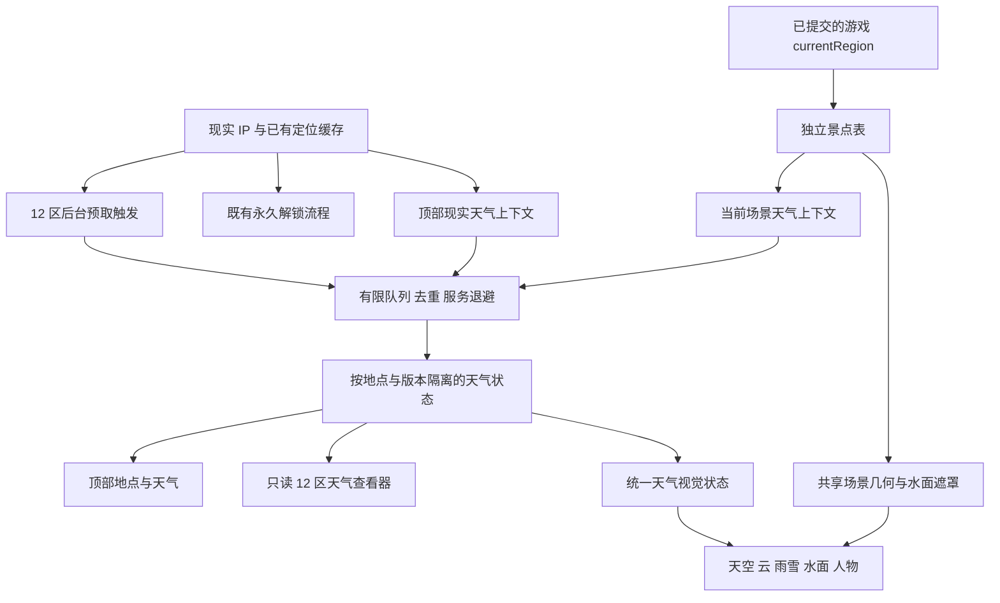

# 水墨改版：独立审查与监督规则

日期：2026-10-23（Asia/Shanghai）。角色：独立监督。产品基线：1.1.1；本轮阶段：需求、分工和验收设计。

**当前结论：文档审查已完成；水墨新功能尚未实现或验收。本页所有功能门禁均待执行。** 不把旧版测试、参考图、空模块、文件存在或程序 exit 0 写成改版通过。

## 1. 职责、输入与修改边界

本角色只维护 `docs/inkwash/roles/review/README.md`，向 Leader 提交风险、边界冲突、证据标准及独立验收交接。不修改产品、数据、资源、其他角色文档或版本；不请求真实 IP／天气，不执行安装或系统操作。检查适用父目录和项目内未发现 AGENTS.md。

输入为[协作入口](../../README.md)、[需求编号 R01–R12／验收 A01–A13](../requirements/README.md)、[两张用户参考](../../references/README.md)、现有 Pond 分层、天气服务与 hook、地区数据以及 smoke 脚本。参考图是风格输入，不是地理证明或动态功能证据；文档中的实现建议也不自动成为用户要求。

输出为本页的风险清单、模块护栏和 G01–G13 证据门禁。后续独立验收角色维护实际运行记录；实现者可提供证据，但不能自行代替独立美术评审或把未测项标通过。

## 2. 已确认的产品口径

以下主口径均已获用户回复，不再作为待确认问题。

| 需求 | 必须保持的关系 | 不允许的替代 |
| --- | --- | --- |
| R01–R03 | 全应用淡彩中国水墨；优化渔翁；现有 12 区各有可识别的真实代表水域／景观 | 只给 Pond 换色；12 区共用背景只改标题；参考图直接当固定白底整图 |
| R04–R07 | 阴天小雪无太阳；雨滴落水扩散，雪花落水消融；雨天斗笠蓑衣、雪天积雪 | 黑龙江永久雪景；用常驻波纹冒充雨滴撞水；把雨雪当同一粒子换颜色 |
| R08／R10 | 顶部天气始终属于现实 IP 地；场景天气属于游戏**已抵达**当前水域代表地，并标地点与来源 | 把机票目的地写入顶部天气；IP 变化偷换游戏场景；在途提前显示已抵达 |
| R09／R11 | 定位及本地天气流程触发 12 区后台预取；按地点独立缓存；失败不阻止单机 | 等待全部地区成功才读档或钓鱼；把同一份本地天气填满 12 区 |
| R12 | 设置中的“查看各水域天气”只读，含未解锁地区；顶部现实天气保持 | 查看时扣票、解锁、改 currentRegion、改场景或伪造天气 |
| 既有护栏 | IP 新地区仍可永久免费解锁；旅行、资产、保存、离线和窗口行为保留 | 为美术换地点而重置存档或调整票价、鱼价、航程 |

现实 IP 从甲变乙：只更新现实天气上下文，并沿用既有规则累计解锁；已游戏所在水域不被天气模块移动。机票从 A 飞 B：出发至抵达前保持在途语义，抵达后切换 B 场景与 B 代表地天气；顶部仍为现实地。查看器选择 C：只切换查看器目标，A／B 场景和资产均不受影响。

具体景点、取景方向、普通多云露日规则、积雪增长／消退节奏由后续角色提出并记录。场景日夜应优先采用对应地点的可靠 `is_day` 或明确的地点时间；这是待定接口细节，不新增游戏时间或经济机制，也不改变顶部电脑时钟用途。

## 3. 基线代码事实与优先风险

以下是当前源代码静态观察，不表示新功能已实现。

| 现状与位置 | 风险／审查要求 | 优先级 |
| --- | --- | --- |
| [Index.jsx](../../../../src/pages/Index.jsx) 将同一 `env.weather/hour` 同时交给顶部和 Pond；[Pond.jsx](../../../../src/components/pond/Pond.jsx) 无地区／场景入参 | 必须拆开现实上下文、场景上下文和只读查看器状态，避免天气错误改变游戏位置 | 阻断实现评审 |
| [environment.js](../../../../src/services/environment.js) 请求温度与 weather_code，最后只输出晴／多云／小雨／雪 | 四标签无法表达阴天、小雪强度和日夜；新增字段须贯通请求、解析、缓存、hook、UI、测试；未知不能伪称已观测 | 阻断真实天气表现 |
| [SkyLayer.jsx](../../../../src/components/pond/SkyLayer.jsx) 由时刻绘制日／月与光晕；[WaterLayer.jsx](../../../../src/components/pond/WaterLayer.jsx) 独立绘制反光 | 只隐藏太阳圆盘会留下晴日日光柱；圆盘、光晕、直射高光和对应倒影必须共享同一可见性结果 | 阻断 R04 |
| 雨雪在 SVG 外的 HTML WeatherLayer；WaterLayer 的 clip 是地平线以下矩形 | 不包含真实岸线和前景遮挡；不能用“在地平线以下”证明落点是水面 | 阻断 R05／R06 |
| [Fisherman.jsx](../../../../src/components/pond/Fisherman.jsx) 只有 palette／pose；[scene.js](../../../../src/components/pond/scene.js) 固定人物、竿梢、漂与岸线 | 衣服、积雪、坐姿与各地几何改动会破坏线端连接和点击锚点；必须共享坐标定义 | 高 |
| 当前 SVG 渐变、过滤器、clip ID 多为固定字符串 | 同页场景预览／测试图集可能互相引用错误；须按实例隔离 SVG ID | 高 |
| [useClockWeather.js](../../../../src/hooks/useClockWeather.js) 为单地点控制器；[weatherRefresh.js](../../../../src/services/weatherRefresh.js) 已有地点竞态、退避与缓存逻辑 | 不应直接复制成 12 个独立轮询器形成请求风暴，或重写时丢失旧的 429／晚回复护栏 | 高 |
| [desktop/environment.cjs](../../../../desktop/environment.cjs) 限制天气请求字段与来源 | renderer 新字段必须与主进程白名单、校验和发行资源一并核验；主进程取消／限流语义不能靠 renderer 测试推定 | 高 |
| 动画混合 CSS 循环与局部 rAF，现有钓鱼场景未建立完整减少动态契约 | 每粒子 React setState／独立定时器会积累开销；暂停视觉不得暂停旅行或存档时钟 | 高 |

现有 12 个稳定 ID 为 `jiangnan / huaihe / huanghe / changjiang / dongnan / lingnan / xinan / yungui / hainan / dongbei / xibei / qingzang`。

[REGION_LOCATIONS](../../../../src/data/regionLocations.js) 是既有航线距离、价格与耗时代表点，**不得为美术／天气换景修改**。东北当前航线点是哈尔滨；若选择漠河北极村黑龙江岸景，须另有景点天气坐标及来源，不能把哈尔滨天气标成北极村当地天气。天气供应商返回的是坐标代表的气象数据，也不能包装成景点实测站观测。

## 4. 建议模块边界与依赖

本节是后续实现建议，最终路径与接口由 Leader／架构角色统一；本轮不创建实现文件。

- **景点表**：一个稳定 regionId 对应 sceneId、显示地点／行政地址、独立天气坐标、坐标来源／核对日期／版本、地貌识别点、几何配置 ID。与交通点、鱼类分布、市场配置分表。美术可提地标，天气坐标需核对，不能根据图片猜测地名。
- **天气领域层**：保留原始 code、云量／天空类别、降水 kind、强度或可用的实测量、isDay、温度、数据时间、获取时间、地点身份及来源；字段缺失使用 unknown／保守降级。降水强度与云量相互独立，不能用“多云”推断不下雪。
- **双轨与调度层**：顶部按现实 IP；场景按 currentRegion→sceneSite；查看器只有 viewRegion。公用有限队列、去重及 origin 级服务等待，前台当前场景／顶部优先于后台预取。可以复用同坐标响应，但不能丢掉各自地点身份与错误状态。
- **视觉状态层**：纯函数把可信天气与时段变成一份 SceneRenderModel；统一输出 sun／moon／stars、对应反射、云、降水、人物衣着与积雪参数。旧缓存不含的新字段不能凭空补成“真实”。
- **几何与绘制层**：保留 1000×440 统一坐标，各 scene 定义岸、水域遮罩、人物与漂锚点。粒子接触事件由同一位置／时间驱动雨涟漪或雪消融；装饰纹理与事件效果分开。天气层不接收购票、解锁、售鱼或资产写入能力。
- **只读 UI**：查看器读 12 区状态，显示地点、天气、更新时间、在线／缓存／模拟／失败；不会调用游戏迁移命令。全局 UI 水墨规范覆盖工具栏、时钟、操作栏、五类面板、状态提示及在途状态。

图中 `UN` 是既有定位授权解锁流程；天气预取、查看器及绘制层不能通过反向依赖调用它。后台预取可以覆盖未解锁地区，不构成到访或获得资产。

### 并行所有权建议

| 工作角色 | 未来独占范围建议 | 集成前依赖／禁止触碰 |
| --- | --- | --- |
| Leader／集成 | 独占 `src/pages/Index.jsx` 接线、跨模块接口裁决、版本与发行入口 | 先冻结 SceneSite／WeatherState／Geometry 契约；Pond 接口修改交渲染，不并发改 pond 目录 |
| 架构／数据 | 主契约、`src/data/sceneSites.js`、`src/config/sceneDefinitions.js` 与景点坐标核验 | 美术交地标、渲染交几何及资源引用；不改 REGION_LOCATIONS |
| 美术 | 视觉规范、分层素材、地区识别点、人物设计与评审输入 | 不能把太阳／人物／降水烘焙入不可分底图；不能改 regionId、景点坐标或经济参数 |
| 全局 UI | 独占 `src/index.css`、`src/components/header/**`、`layout/**`、`panels/**` 与天气查看器 | 地点标签仅负责 header／viewer；Pond 内地点标签由渲染负责；Index 只提交接线建议 |
| 天气实现 | provider 解析、缓存版本、调度、双轨 hook、只读天气数据 | 依赖景点坐标核对；不得改游戏存档主 schema、旅行或资产命令 |
| 渲染实现 | 独占 `src/components/pond/**`，包括 Pond／palette／scene、Pond 内地点标签、几何、分层组件、降水接触及人物天气状态 | 依赖视觉状态和遮罩契约；不能自行取网络天气或重定义来源；与 Leader 交接 Pond props |
| 独立监督／验收 | 代码审查、自动断言、截图矩阵、性能和发行证据 | 与实现者区分；失败直报，禁止降低要求消除失败 |

并发受可用 agent 数限制，采用分批交接；每个文件有单一负责人。先做黑龙江阴雪、秦淮雨景、珠江宽江三地样板，再铺开 12 区；全局 UI 可在主题契约冻结后并行。新增大型依赖、纹理／字体包先说明用途、资源大小和维护成本。

## 5. 功能与证据门禁

所有 G 项当前状态为**待执行**。自动化能证明关系、尺寸和事件，不能自行证明中国水墨质感、地域可识别性或人物笔触质量。

| 门禁 | 对应需求 | 可自动验证的最低条件 | 必须补充的人工／实机证据 |
| --- | --- | --- | --- |
| G01 需求追踪与全应用范围 | R01–R12／A01–A13 | 每个需求关联实现／资源／测试／证据与未测状态；12 区与场景表一一覆盖，无未知／重复 ID | 按主界面、时钟、工具栏、操作栏、五面板、提示／空／错／加载／在途逐项视觉评审；不能只评 Pond |
| G02 真实地点与交通隔离 | R03／A03、A12 | 所有 sceneId 有地点名、地址、独立有效坐标、来源及版本；航线坐标、132 条有向航段及经济配置对照基线不变 | 12 地图集说明每区的水域轮廓及第二识别点；核对地点与参考资料，不能只改名／颜色 |
| G03 双天气与旅行时序 | R08／R10／R11 | 现实甲晴、场景乙雪；再改 IP 丙雨：顶部更新、原解锁保留并累计新解锁，金币／homeRegion／currentRegion 不因天气改变。购票在途不提前抵达，抵达后仅场景换目的地天气；两轨晚回复各自隔离 | 同屏展示两地点不同天气、在途与抵达截图；正常旅行和现实免费入口沿用既有命令语义 |
| G04 只读查看器 | R12／A13 | 逐个查看全部 12 区含未解锁区，前后金币／鱼获／解锁／homeRegion／currentRegion／travel 不变；当前场景身份及天气不切换，顶部仍为现实地 | 两档窗口查看器可读；地点、来源、更新时间和单区错误清楚，不产生“已到访”误导 |
| G05 12 区调度与服务等待 | R09／R11／A09 | 冷缓存预取覆盖 12 个唯一地点；有限并发／超时／队列长度有显式预算；重复 focus／online／IP 事件去重，命中缓存不重复刷；顶部与当前场景优先；单区失败不 reject 整组、不阻塞读档／钓鱼；HTTP429、HTTP200配额错误、Retry-After均不被手动刷新或切区绕过 | 请求时间线记录峰值并发、尝试数、命中数、重试时间和部分失败。建议初始并发上限 2，具体数值由天气角色定稿，不以无限并发换取“同时” |
| G06 天气归一化与缓存兼容 | R04／R08–R11 | 覆盖晴／少云／多云／阴／雨／雪／混合或未知 code、缺字段、无效时间／坐标；保留原 code、云与降水分离、强度和日夜；现实／场景／12 地缓存互不污染；旧缓存缺新字段安全降级或失效重取，不重置游戏存档 | 对照 code→视觉状态表审查“小雪不是大暴雪”；有效缓存、过期缓存、模拟和在线明确区分，不编温度或真实强度 |
| G07 太阳及反射共同门禁 | R04／A04 | 白昼晴／普通多云按定稿规则；阴、雨、雪与夜间不得出现不适用太阳圆盘、光晕、晴日日光柱／碎光；月亮／星点另遵统一规则。场景使用场景时段依据，不能靠当地电脑时钟假定所有地方白昼 | 黑龙江白昼阴天小雪与同景晴天、夜间连续对照；人工核查底图是否偷偷残留固定太阳或金色反光 |
| G08 水面遮罩与不同落水 | R05／R06／A05、A06 | 固定随机种子／时钟，逐 scene 抽样命中坐标及边界，落点在真实水域内、排除岸／前景／人物；雨到达事件后同点椭圆扩散淡出，雪在接触处消融，不越水面继续飞；切区／切天气旧事件有界清理 | 秦淮雨与雪相同水面位置连续帧／短录像；仅静态涟漪或源文件有 mask 不构成通过；核查透视与岸边接触自然 |
| G09 人物、积雪与钓线 | R02／R07／A02、A07 | 晴→雨→雪→晴和切区，服装／积雪按定稿规则切换、无错误残留；待机／咬钩／收竿竿梢—线—漂端点一致；层不拦截 poke／catch | 420×350 和 640×490 人物细节、斗笠蓑衣、衣褶留白、积雪附着与参考对照。姿态是否有传统水墨质感由人评审，DOM存在不能代替 |
| G10 两档布局与桌面适配 | R01／A01、A12 | renderer 客户端严格 420×350／640×490，html/body/root无滚动溢出；场景、所有面板／按钮在viewport内；drag／no-drag、pin、minimize／restore、X退出、设置与位置重启恢复 | 实际透明桌面浅／深背景、DPR 1／1.5／2；人工核查文字、人物、浮漂、阴雪低对比状态。外框取整记录不能放宽客户端尺寸；原生拖动另测 |
| G11 性能与减少动态 | A01、A05–A07、A12 | 粒子／事件池有硬上限；切换与卸载清理timer/rAF；隐藏／最小化暂停纯视觉工作；prefers-reduced-motion／产品低动态入口仍保留天气辨识与鱼讯，不改 catch/travel/save 时间 | 在明确硬件上记录冷启动、最复杂雨雪、后台／恢复、持续运行和反复切区的帧耗时／CPU／内存；先定预算再测，不能只凭“看起来流畅” |
| G12 旧档、离线与资产不变 | A12／既有护栏 | 导入基线旧档，金币／背包／解锁／旅行／时间戳恢复；七天鱼价、区域市场、航程与耗时仍按原规则；断网冷启／有缓存／过期缓存均可游玩；预取失败不写资产、不丢保存 | 关闭重开真实应用，离线钓鱼／售鱼／旅行与存档恢复记录；不把 mock 天气成功当作真实联网成功 |
| G13 构建与发行真实性 | 全部 | 本地资源完整进包，源码／bundle／ASAR／发行hash匹配，禁止外部CDN依赖；真实生产bundle能接收测试环境的合法天气输入 | 正常安全选项的最终 EXE 独立profile启动／显示／退出、ZIP资源核对。显式关闭沙箱的宿主诊断另记，不能代替发行正常启动 |

### 调度与缓存专项故障集

G05／G06 至少覆盖以下组合，不需要向真实定位服务发送请求：

1. 现实定位成功但顶部天气失败；顶部成功但部分 scene 请求超时；12 区全部失败；已有有效缓存时服务失败。
2. 冷启动、断网启动、online／focus 风暴、IP 连续变化、flight 中切看天气、抵达前后晚回复交错。
3. 当前地区 A 的旧请求晚于 B 抵达返回；相同坐标可去重但不同身份的来源标签不串；景点坐标版本变更不误用旧地点缓存。
4. 单地点失败与供应商 origin 级429分开处理；429及HTTP200配额错误携带长 Retry-After，剩余队列／查看器刷新不能生成绕过请求。
5. 关闭在线功能／窗口销毁／新一轮地点更替后，旧回调不得覆盖新状态或继续无限扩张任务。跨 IPC 请求取消能力按实际实现单独记录，不能由 renderer AbortSignal 存在就宣称主进程请求已立即终止。
6. 旧 weather 缓存只含四标签；新字段缺失、未来时间、过期、坏JSON、供应商缺观测值等。降级有来源，不把缺失 isDay／强度编造为真实。

“同时获取各水域”按后台启动批次解释，不要求同时开12条连接。请求预算应至少写明：前台／后台优先级、并发上限、刷新TTL、最短手动间隔、每轮尝试上限、超时、共享服务等待、恢复策略与去重键。按已选供应商能力决定单点还是批量请求，不在本页虚构其配额。

## 6. 美术评审与截图取证

先用三地样板评审淡彩、层叠虚实、飞白笔触、人物轮廓和可读性，样板未通过不把低质量模板扩展为12套。之后至少交付 12 区同一晴天条件下的两档截图图集，并补云／阴／雨／雪／夜间的状态覆盖表；雨、雪、复杂岸线和人物细节需要专项连续帧。自动渲染可以覆盖全部状态组合，人工评审需明确实际看过的组合，未看的不能默认通过。

两张用户参考显示的是淡彩水墨与有层次的传统渔翁，不要求纯黑白。人工评审记录至少包含：需求编号、场景／尺寸／天气、参考对照、通过／失败／待调整、具体原因、评审者与日期。不能仅用像素差阈值证明“好看”“像秦淮”或“人物笔触达到参考”。

截图必须来自实际新 UI／实际生产bundle，保留场景地点、天气来源和窗口尺寸。用注入合成供应商响应或可控时钟可以验证映射与动画，但标记为 mock／固定时钟，不能声称联网已测；生产不生效的 `?weather=`／`?hour=` 参数不能当作生产天气入口。静态临摹页面与源代码镜像不作为实际 UI 证据。

证据元数据应记录：源提交／dirty摘要、构建与资源hash、运行模式／沙箱、profile隔离、网络阻断或真实请求范围、provider输入、地点键、code／视觉状态、时钟与种子、inner／outer尺寸及DPR、截图／录像位置、测试命令与退出码、失败日志。报告先写失败与未测，再列已通过内容；测试异常也须落盘，不以零断言通过。

## 7. 技术债与合并审查顺序

| 债项／决定 | 本轮应做的控制 | 可推迟但必须登记的内容 |
| --- | --- | --- |
| 旧四标签天气缓存 | 定义新版兼容／失效，不迁移或重置游戏主档；保留来源和未知字段语义 | 更细的雷暴／冻雨／风向艺术表现 |
| 12 控制器复制 | 共用受控调度、网络等待和地点状态，避免12份轮询／重试 | 后续供应商替换适配，不能硬编码到渲染组件 |
| 固定场景几何和 SVG ID | 一处定义岸、水面、锚点，实例ID隔离；共享接触事件 | 复杂物理水体、真实流场或骨骼系统不属于首批 |
| 人物积雪记忆 | 先作为有界视觉状态，明确切天气／切区／重启的规则 | 持久积雪如需入档，另提需求与迁移，不偷增永久字段 |
| 新素材体积与依赖 | 资源本地化、体积清单、许可证／来源与可再生成记录 | 不能用未使用的大型引擎或整套字体掩盖结构问题 |
| 验收脚本可信性 | 保留真实入口、失败报告、超时与清理；mock／诊断／正式证据分开 | 不重跑旧全套测试来假装新美术通过 |

审查顺序：需求与景点契约 → 天气归一化／缓存／队列 → 三地视觉样板 → 统一几何与落水事件 → 双轨／查看器集成 → 全量12区与全局UI → 旧档／离线／性能 → 实际发行。每个变更检查是否越界修改REGION_LOCATIONS、资产命令、save schema或已有网络安全限制。

以下情形阻止宣称功能完成：双轨／查看器会改资产，使用错误景点坐标冒称当地天气，指定阴雪仍有太阳／日光反射，粒子无水域接触关系，所有后台请求失败导致不能游玩，429被切区绕过，旧存档重置，客户端尺寸溢出，或只提交静态素材和旧测试结果。

## 8. 本轮留痕与交接状态

- 已只读检查 Pond、SkyLayer、WaterLayer、WeatherLayer、Fisherman、scene、palette、useTween、Index、useClockWeather、environment、weatherRefresh、desktop网络白名单、地区配置及既有 smoke／验收文档；已查看两张参考图。
- 已互读本轮协作入口、需求角色与参考说明；以 R01–R12／A01–A13 为主追踪号。后续角色文档尚在并行形成，不据此推定它们已通过审查。
- 已完成静态风险与验收规则设计；未运行新功能测试、GUI、安装器、联网定位／天气或性能压测；未改游戏代码、版本、配置和发行物。
- 本角色唯一新增文件为本 README。后续独立验收角色按 G01–G13 建实际结果台账，每项写通过／失败／未测及证据；功能门禁本轮全部保持待执行。
