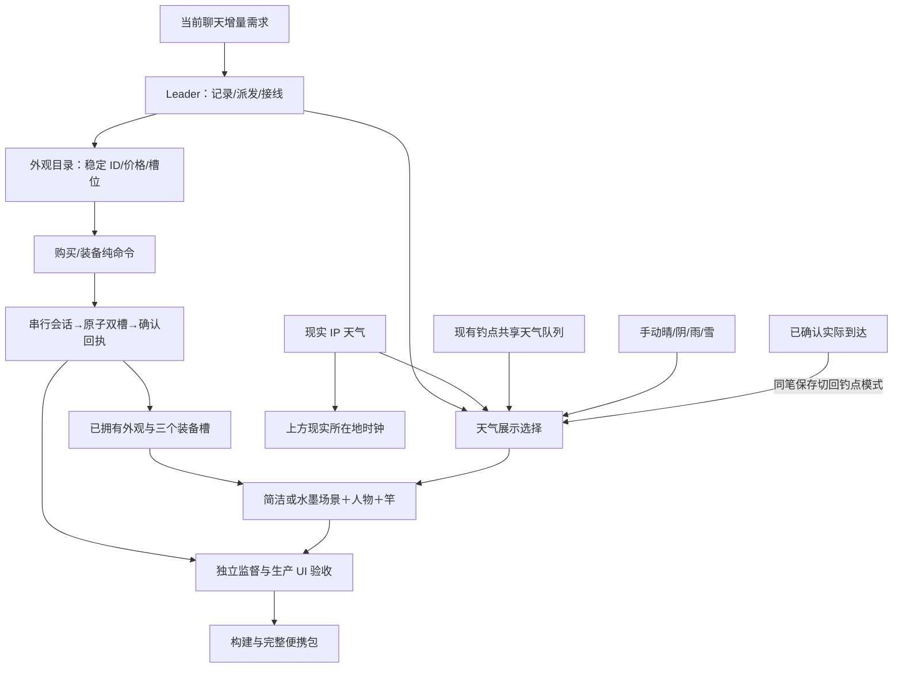

# 1.3.0 · 自选外观与天气

日期：2026-10-25（Asia/Shanghai）。基线：`e4d87f3`，上一版完整交付为 1.2.0。

状态：**1.3.0已完成本地交付**。272项测试271通过/1安装跳过；生产UI10组、普通最终EXE离线启动/退出、50包内文件与76个ZIP文件核对通过。[实际验收](ACCEPTANCE.md)、[实施与技术债](IMPLEMENTATION.md)、[发行记录](../RELEASE.md)。以下保留当时接口冻结与派发过程。

## 本轮用户要求

恢复上一版简洁、轻盈的默认画面；水墨保留为商城中的可选美术资源包。玩家可以用卖鱼所得购买插画风格、鱼竿外观和人物皮肤，并分别搭配。用户提到“光遇”用于说明轻盈氛围，不能据此复制该作品的角色或素材。

场景天气可以手动选晴、阴、雨、雪，也可以跟随现实所在地或钓鱼点；到达漫游目的地后跟随该地天气。上方时钟继续保留现实所在地。天气查看器和真实天气缓存不因展示选择被改写。

继续执行[本轮开发规范](DEVELOPMENT_STANDARD.md)与继承的事务护栏：独占文件、集中数值、确认保存后反馈、旧档先备份、独立审查与证据留痕。附件和旧 README 是项目资料；本轮最新用户要求优先于历史全界面水墨方案。

## 实施与待确认

- 已完成：默认简洁画面、可混搭的本地资源目录、外观交易与存档迁移、天气展示模块、商城与设置接线。
- 已确认：用户选择游戏金币购买，本次完成。水墨包1800，云游/暮色旅人各650，青玉竿350，晨光竿500；这些金额是集中配置的工程默认，不冒称用户指定。
- 已确认：广州钓点背景可显示现实东莞天气或广州景点天气，漫游后显示新钓点天气；保留原始要求中的手动四种天气，并明确标为手动。
- 工程默认：外观不改变鱼价、鱼种、咬钩速度和鱼竿等级；内置资源离线可用，切换不依赖下载。

## 分工与文件所有权

| 角色 | 独占范围 | 交付 |
| --- | --- | --- |
| Leader | Index、useFishingGame、商城/设置、样式、版本与发行、此索引与团队台 | 接线、状态回执、界面与最终交付 |
| appearance_domain | appearance 配置/纯规则、gameState、saveSchema、storage 配置及必要 repository 适配 | 所有权/装备/扣费、schema3 迁移与测试 |
| appearance_art | pond 渲染、外观视觉配置、渲染测试 | 简洁画面恢复、水墨保留、人物与竿混搭 |
| weather_modes | 展示配置/纯选择器、新 hook、天气选择测试 | 展示与真实数据分离，不增加请求 |
| style_supervisor（第二批） | 只读审查、独立规则/故障检查、生产 UI 验收脚本 | 独立4组规则与最终报告/截图复核，无阻塞发现 |

角色记录：[规则与存档](roles/domain/README.md)、[美术](roles/art/README.md)、[天气](roles/weather/README.md)、[独立监督](roles/review/README.md)。各角色实现与自测已交接；最终生产 UI 与发行证据由 Leader 补充。

## 目标与验收

1. 新档和旧档升级后默认简洁风，旧金币/鱼获/物品/航程/图鉴不变。
2. 余额不足、未知商品、未拥有外观不能扣费或装备；重复购买不重复收费；购买和装备均经保存确认。
3. 场景、人物、竿独立搭配，免费恢复默认；切换没有数值收益，卸载/重开保留权益。
4. 手动天气明确标为手动，不能冒称实况；现实与钓点不同天气可验证；实际到达自动跟随目的地。
5. 两档挂件尺寸、全部地区、雨雪触水、浮漂与竿线、离线重启、失败存档均检查。
6. 单测、lint、构建、最终 ZIP 资源一致性分别留证，未测安装器/真人听感/真实联网不称通过。

