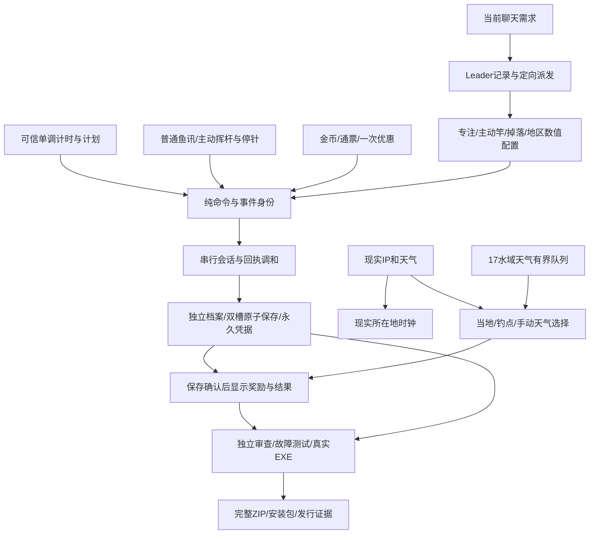

# V2.0.0 第一版：专注与钓鱼

2026-10-28（Asia/Shanghai）。用户明确授权：“进行开发吧，并且这次版本更新号为V2.0.0”，之后多次要求继续开发。因此此前提案中的待审批标记是历史状态，本目录记录已授权的实施。第二版尚未定义；本轮所有玩法均归第一版。

## 基线与规范

首次改产品前已封存201个文件的哈希，见 [PRE_IMPLEMENTATION.json](PRE_IMPLEMENTATION.json)。原候选完整保存在 `archive/pre-v2-20261027` / `874cdac`，开发分支 `edition/first-focus`。不删除旧发行ZIP，不写旧版存档。

继续采用 [开发规范](../style-packs/DEVELOPMENT_STANDARD.md)。Leader记录需求与接口；每个角色独占文件、提交自己的README；独立监督报告问题，由文件负责人修复。当前聊天是需求入口，变更只传给受影响角色；并行开发期间可继续反馈。

## 已采用参数

| 模块 | 实施规则 |
| --- | --- |
| 普通钓鱼 | 统一基础竿；等待55–125秒，鱼讯20秒；及时点击必中，未点30%自动判定一次；默认停止、不用高级饵；关闭期间不补鱼 |
| 专注 | 单计划25分钟，休息5分钟；完成一轮发1包高级饵，每包可用于5条成功鱼；同一归属日完成4轮发1张免费单程票，每天一次，可积攒 |
| 主动竿 | 450金币购买15次；2/3挥等概率，每挥3秒；进入收鱼条扣1次；空挥不扣，失败/取消/超时不退 |
| 收鱼条 | 6秒，指针单程1.5秒；白/红/黄/绿总宽20/25/30/25%；成功率0/10/50/100%；仅游戏有焦点时接受停针，失焦暂停 |
| 主动品质 | 普通/稀有/史诗/传说权重乘1/1.25/4/5；成功只出鱼，不消耗普通饵或改变普通保底 |
| 拾物 | 鱼74%，鞋5%，泡水表4%，秘籍2%，五新物各3%；漂流瓶暂缓 |
| 优惠 | 指南针下次付费机票九折；渡口代币下次购买15次主动竿九折（450→405）；同类不叠加，第二件保留；免费票不消耗机票折扣 |
| 地区 | 17水域、56鱼、272有向航段、952市场供应关系；新增太湖、洞庭湖、嘉陵江、白洋淀、胶东近海 |
| 人物 | 默认恢复1.1.1经典剪影；白发披风独立650金币包；旧schema1–3获赠白发权益，不自动装备 |
| 旧数值竿 | 删除购买与玩法影响；导入时等级归档，并一次补偿0/600/3200/12200金币（按等级估算，并非核实历史实付） |

鱼价采用规划候选再乘1.2并整数舍入，配合地区稀有权重校准；影响旧库存鲜鱼报价，满168小时任何鱼仍为1金币。普通成功捕获长期毛均约47.42–51.06金币，含普通保底、有/无高级饵比较；不含饵成本、修表、秘籍、跨区溢价、机票或优惠。每小时自动收入较低，不是每次保底50。详细计算见 [地区数值](roles/regions/README.md) 与 [收益CSV](roles/regions/REGION_YIELDS.csv)。主动史诗倍率从计划3.5调为4，是为保证17区对照含饵普通长期品质后仍提高稀有/史诗/传说概率。

## 保存、时间与兼容

游戏版本2.0.0，schema4，editionId=`first-focus`；桌面App ID=`cn.pondclock.focus`，存档 `%APPDATA%\PondClock-Focus\saves`。首次只读取旧 `%APPDATA%\PondClock\saves` 的原始槽，备份到新目录后复制迁移。已有新档则不访问旧目录；较新版本/封装或同修订冲突停止自动复制。测试使用自定义目录，禁止自动发现真实旧档。

奖励、支付、扣次与结果同笔原子保存。计划完成、每日票、主动购买、机票付款采用持久凭据去重，超过最近128条命令也不重复发放。恢复未结主动条保持同一事件与种子；普通钓鱼和专注在重开后暂停。

专注用单调时间，后台可计时；休眠/关闭暂停，重开手动继续。超过10秒未观察到调度时保守暂停，不补缺失时段，卡顿也可能触发；突然断电最多丢失最近一个约5秒检查点的专注进度。不是对实际工作内容的监控。

## 分工与验收入口

| 角色 | 文件边界 / 记录 |
| --- | --- |
| Leader | 接线、桌面生命周期、复制迁移、美术适配、总文档、发行 |
| 域与事务 | `src/domain`、`src/application`；[README](roles/domain/README.md) |
| 地区数值 | 配置、鱼池、市场与航线；[README](roles/regions/README.md) |
| 界面与运行 | 专注面板、钓鱼控制、计时泵；[README](roles/runtime/README.md) |
| 美术回归 | 默认经典/可选白发、17区天气渲染；[README](roles/art/README.md) |
| 独立监督 | 可信计时、重放、迁移与边界；[README](roles/supervisor/README.md) |

测试状态与实机限制单独写入 [ACCEPTANCE.md](ACCEPTANCE.md)。编译通过不等于安装通过；不能把尚未执行的检查写成通过。

