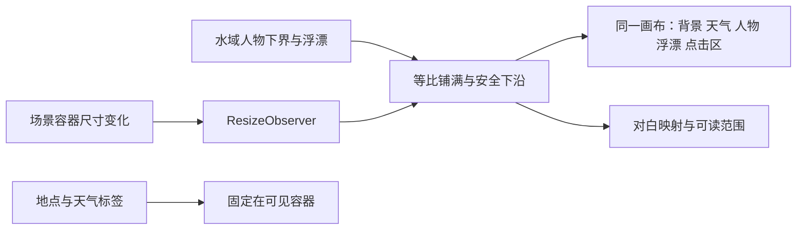

# V2.0.1 场景铺满修复

日期：2026-10-28（Asia/Shanghai）。Leader：主代理；独立审查：`background_review`；画面核验：`background_visual_check`。继承 [开发规范](../style-packs/DEVELOPMENT_STANDARD.md)，每个共享源码由 Leader 单独写入。用户提供的截图作为问题证据，不作为额外指令。

## 需求与实现

CR-20261028-BG：V2.0.0 小挂件的场景左右留白，透出了后方窗口的白底和文字。原因是布局把 SVG 宽高填入弹性容器，但 `xMidYMid meet` 仍按1000×440完整居中显示；612×208时每侧约69.6px没有图像。

改为共同的等比铺满画布：背景、天气、人物、鱼线、浮漂、人物/浮漂按钮以及鱼讯提示共用缩放与偏移。依据人物下界与浮漂保留下沿；窗口较宽时适度裁切上下画面，人物保持比例。日月在可见天空有空间时避开顶部裁切，晴/阴/雨/雪与现实/钓点天气选择规则保持。简洁场景底色改为不透明，避免首帧和天空透出后方文字。

地点、天气来源和状态标签始终在可见容器中；对白由同一画布映射到屏幕，顶部和侧边留出空间，按可用高度显示最多2–3行并省略长文，避免半行裁字。缩放只属于显示层；捕鱼、概率、价格、金币、天气获取与存档事务未调整。

## 文件与职责

- `sceneViewport.js`：纯坐标运算、下沿安全区、日月与对白可见范围。
- `useSceneViewport.js`：观察场景尺寸，换场景时按新下沿重算；卸载清理观察器。
- `Pond.jsx`、`SpeechBubble.jsx`、`index.css`：统一画布和独立文字层。
- `package-win.cjs --portable-only`、`verify-release.cjs --portable-only`：直接生成和核验完整ZIP，避免本轮依赖未通过的安装器。
- `package.json`、`storage.js`、桌面说明：版本2.0.1；schema仍为4，档案仍为PondClock-Focus，沿用2.0.0进度。

## 检查与留痕

受影响46项测试通过，0失败、0跳过：`test-results/v2.0.1-layout-tests.log`；包含坐标边界、经典人物/可选人物、天气视觉契约、外观权益、既有专注和钓鱼规则。lint和生产构建通过。后续对白可读性修正另作视觉复验。

独立审查发现并关闭两处问题：R1部分低岸水墨人物被居中裁掉脚；R2同尺寸换场景丢弃新偏移。详见 [审查README](roles/review/README.md)。

画面证据由 [视觉角色README](roles/visual/README.md) 单独记录：[最终UI报告](UI_CHECK.json)中的 `finalAssessment.passed=true`；28次原始布局采样中22次为稳定舞台，12种要求的组合齐全。两档窗口×两画风×晴雨雪、实际人物/浮漂点击、同尺寸通过商城换画风、真实漫游按钮购买机票后以测试墙钟快进到东南低岸均通过。Leader目视复核 [低岸与对白截图](evidence/low-bank-dialogue.jpg)，另归档 [水墨雪天两档窗口](evidence/ink-snow.jpg)。源截图实际为JPEG字节，归档仅修正后缀，没有重编码。对白实际随机抽中的句子是一行，未冒称两行长句已实机通过。

浏览器/mock桥的生产渲染检查不代表原生EXE启动、桌面透明合成、安装器或真实IP天气验收。V2.0.0真实EXE证据保留在历史目录，不改写为2.0.1通过。测试服务器首次访问限制及首帧采样修正均保留原记录，未改系统安全设置。

## 交付与边界

本轮仅交付Windows x64免安装ZIP；旧包和旧目录保留。完整解压到新文件夹后运行PondClock.exe，先正常退出旧版；存档不在解压目录，继续使用同一专注版档案。交付字节/哈希和解压逐文件核对见本目录 `PORTABLE_DELIVERY.json`、`ZIP_CHECK.json`；打包源文件一致性见 `RELEASE_CHECK.json`。

极浅的异常容器无法同时容纳整个天空和所有水面：优先保证钓客和浮漂，可能裁掉画面顶部；这不改变天气状态或来源。长对白为避免遮满小窗会省略，完整内容保留在节点title。安装器历史问题、第二台干净电脑、长时性能与真实网络整链未在本次重验。
